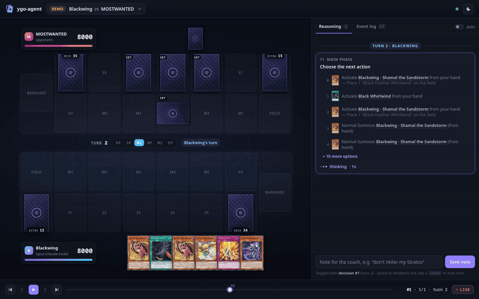

# ygo-agent

[](https://github.com/mostwanted7/ygo-agent/actions/workflows/ci.yml)

An AI opponent for [EDOPro](https://projectignis.github.io/) that pilots a real deck and explains itself. It hosts a
duel room on your machine; you join from EDOPro and play, while every decision, its reasoning and its plan for the
turn appear in your terminal and in a local web panel. The same agent narrates its own games for someone learning a
deck (teach), coaches you while you play yours in EDOPro (coach), trains itself on a new deck from a `.ydk` file,
and can be benchmarked against WindBot deck AIs. By default the decisions come from Claude through your Claude Code
login (no API key); the Anthropic API, any OpenAI-compatible server (Ollama, vLLM, llama.cpp, LM Studio, OpenRouter)
and two no-LLM baselines are backends too. Three decks ship with it (Saffira, Blackwing, Geargia), each with a
playbook the agent reads on every decision and that improves from your feedback after each game.



## Quick start

You need Linux, EDOPro in `~/Games/ProjectIgnis` (or set `edopro_dir`), Python 3.11 or newer, Mono (`mono`, `xbuild`)
for the WindBot fork, and the `claude` CLI logged in (or another backend, see [docs/backends.md](docs/backends.md)).

```sh
git clone --recursive https://github.com/mostwanted7/ygo-agent.git && cd ygo-agent
./build.sh                                                    # the WindBot fork in windbot-src/ (opponents, play --join)
python3 -m venv .venv && .venv/bin/pip install -e '.[dev]'    # the ygo-agent command and pytest
.venv/bin/ygo-agent doctor                                    # checks the setup and says what is missing
.venv/bin/ygo-agent play                                      # hosts a room and prints where it is
```

Then in EDOPro: **LAN Mode**, type the Host address `127.0.0.1` and port `7911`, **Join**. Type the address rather
than waiting for the room list: EDOPro may not list the room, and its LAN Refresh button can crash EDOPro. Pick your
deck, ready up, and the duel starts. You get 600 s per turn (`--time-limit`); the AI has no limit. EDOPro offers a
rematch after each game; Ctrl+C closes the room and prints the results.

While you play, the terminal shows every decision: the options, the choice, why, and the plan for the turn. The duel
chat stays quiet apart from a few jokes per duel (`chat = "off"` in the config silences them). Type `!` followed by a
note in the duel chat (`!don't Veiler my Stratos, save it`) to bookmark feedback at that moment; the bot confirms it
and the note lands in the game's `feedback.md`. After the game, the log is in `games/latest/` (`game.md` to read,
`feedback.md`, the raw `game.jsonl` and `prompts.jsonl`, `meta.json` with the stats, and `replay.yrpX` for EDOPro's
replay menu). Open Claude Code in this folder and tell it what the AI got wrong: it fixes the deck's playbook or
rules (the procedure is in `CLAUDE.md`), and the next game uses them.

## Features

Every command takes `--deck NAME` (a deck `ygo-agent decks` lists, a `.ydk` file or a deck in EDOPro's deck folder),
`--backend NAME` (default `opus`, the play model; see [Benchmark](#benchmark-and-exam-results)), `--model` and
`--effort` to override the profile's, and `--help` for the rest.

- **Play.** `ygo-agent play --deck blackwing --web`. The agent hosts the room (Master Rule 3 by default, `--rules
  MR5` etc.; `--port`, `--password`, `--best-of 3`, `--games N` to close the room after N matches, `--chat off`).
- **Play in a room you host** (the older way, through the WindBot fork). Host a LAN duel in EDOPro with a long time
  limit, run `ygo-agent play --join` (`./play.sh` does the same) and press Enter once you are in the room; the
  agent's bot joins it. `--host`, and `--brain-only` to run only the agent and print the bot command.
- **Self-play.** `ygo-agent selfplay --a saffira:opus --b blackwing:sonnet`. A seat is `<deck>[:<backend>]`,
  `heuristic` or `random` (no LLM; `heuristic:blackwing` picks the deck), `windbot:<deck AI>` (EDOPro's WindBot deck
  AIs; `python -m ygo_agent.arena list-bots` lists them) or `human`. Two AI seats play in-process, straight on the
  game engine; `--games N --parallel K --quiet` runs many at once. `--spectate --pace 2` hosts the room on port 7911
  and waits for you to join as a spectator before each match (both seats are taken, so you watch), with at least
  2 s per AI decision. Also `--seed S`, `--first a|b`, `--stack-a "Card,Card"` (A's opening hand), `--best-of 3`,
  `--out DIR`. Both seats log their games, so the feedback loop works on self-play games too.
- **Teach.** `ygo-agent teach --deck blackwing --web`: the agent plays a WindBot deck AI (`--opponent
  windbot:Dragunity`, or an AI seat such as `saffira:sonnet`) and explains every play like a coach, with its plan for
  the turn in the terminal and the panel. Join as a spectator (LAN Mode, `127.0.0.1`, port 7911), or press Enter to
  watch in the browser only. `--pace 3` slows it down. `ygo-agent teach --join` is the room-you-host variant.
- **Coach.** `ygo-agent coach --web`, then join from EDOPro as for `play` with the deck you are learning. You play
  every move; for each decision the terminal and the panel show the coach's recommendation with a short reason
  (`--level intermediate` for terse ones) and whether you followed it. After the game it writes `review.md` and
  shows it in the panel. The deck is recognised from the list you submit (`--deck` names it); the opponent is a
  WindBot deck AI (`--opponent saffira:sonnet` for an AI deck). 1200 s per turn (`--time-limit`).
  `ygo-agent coach --review games/<dir>` reviews a coached game again. See [docs/coach.md](docs/coach.md).
- **Web panel.** Add `--web` to any of the above (`[web] auto = true` makes it the default) for
  http://127.0.0.1:7930/: the board with card pictures, every decision with its options, choice, reasoning and plan,
  the event log, and a note box that works like a `!note`. `ygo-agent web` browses and replays recorded games;
  `ygo-agent web --demo games/<dir>` replays one as if live. See [docs/web.md](docs/web.md).
- **Train a new deck.** `ygo-agent train ~/Games/ProjectIgnis/deck/Geargia.ydk --name geargia --budget-usd 40`,
  then `ygo-agent play --deck geargia`. The trainer reads every card and its script, writes a playbook, tests its
  lines in a lab (stacked hands against a dummy that never acts), plays games against WindBot deck AIs, reviews them
  against the scripts and the engine log, and repeats until a round shows no significant mistakes. The deck goes to
  your own decks dir (`~/.local/share/ygo-agent/decks/`; `--into repo` puts it in `decks/`). `--resume` continues a
  stopped run; `ygo-agent train-compare --name geargia` shows what the training bought. See
  [docs/training.md](docs/training.md) and [docs/adding-a-deck.md](docs/adding-a-deck.md).
- **Benchmark.** `ygo-agent bench readme` plays the README benchmark (same seeds for every backend, resumable);
  `ygo-agent bench exam` grades models on the same logged decisions with a blind judge; `ygo-agent bench smoke`
  checks the pipeline in a minute without an LLM. See [docs/bench.md](docs/bench.md).
- **Replay and test.** `ygo-agent replay games/latest 14` re-asks decision #14 with the current playbook and rules;
  `--save NAME --expect '[[2]]'` keeps it as a regression case, and `ygo-agent test` re-runs every case of the deck
  (`--ablate-rules` finds hard rules the model no longer needs).
- **Backends.** `--backend sonnet` or `haiku` (faster, cheaper, more mistakes), `api-opus` (the Anthropic API),
  `local` (Ollama), `heuristic`, `random`, or a profile of your own. See [docs/backends.md](docs/backends.md) and
  [docs/adding-a-backend.md](docs/adding-a-backend.md).

## Benchmark and exam results

The AI piloting Saffira and Blackwing against two Master Rule 3 WindBot deck AIs, Blue-Eyes and Time Thief (Bo1),
on 2026-10-21. Every backend gets the same seeds, and the AI seat alternates between going first and second. This is
a **small-sample pilot** with wide intervals: 12 games each for Haiku and Sonnet, 4 for Opus (game 1 of each pairing
only, always going first), and 120 each for the baselines.

| Backend | Games | Win rate (95% CI) | Game 1 only (same deals, going first) | Time per game | Decision latency p50 · p95 | Cost per game | Invalid replies |
|---|---:|---|---:|---:|---:|---:|---:|
| Opus 5.5 (`opus`) | 4 | **100%** (51%–100%) | 4/4 | 2m51s | 2.7s · 7.5s | $1.15 | 0 of 186 |
| Sonnet 5.5 (`sonnet`) | 12 | **58%** (32%–81%) | 3/4 | 3m05s | 1.9s · 5.5s | $0.80 | 0 of 871 |
| Haiku 5.5 (`haiku`) | 12 | **58%** (32%–81%) | 1/4 | 3m03s | 1.6s · 9.0s | $0.06 | 0 of 754 |
| heuristic (no LLM) | 120 | **22%** (15%–30%) | 1/4 | 6s | – | free | – |
| random (no LLM) | 120 | **2%** (0%–6%) | 0/4 | 6s | – | free | – |


**The play model is Opus**, chosen by a blind decision exam rather than by these few games: 40 logged positions
re-asked of each model and graded blind (a second, Sonnet judge agreed), plus a blind review of 4 like-for-like games
per model ([report](bench/exams/results/2026-10-22_014130_main/report.md),
[method](docs/bench.md#choosing-the-play-model)).

| Model | Mean grade (of 4) | Best move | Mistake or blunder | Cost / decision | Significant mistakes / game |
|---|---:|---:|---:|---:|---:|
| Opus 5.5 | **3.73** | 88% | 5% (0 blunders) | $0.071 | **0.25** |
| Sonnet 5.5 | 3.30 | 72% | 15% | $0.031 | 1.0 |
| Haiku 5.5 | 3.15 | 62% | 15% | $0.002 | 2.0 |

Cost is the Claude Code CLI's figure at API prices (a subscription login isn't billed per call); no game needed a
fallback. The full report, with every game's EDOPro replay, the per-matchup tables, ratings and versions, is in
[bench/results/2026-10-21_212557_readme/report.md](bench/results/2026-10-21_212557_readme/report.md). Run it yourself
with `ygo-agent bench readme` (`--resume` extends a run on the same seeds), or benchmark a local model by adding an
OpenAI-compatible profile and running `ygo-agent bench --backends local,haiku,heuristic --decks saffira,blackwing
--opponents "windbot:Blue-Eyes,windbot:Time Thief" --games 6 --parallel 1`. See [docs/bench.md](docs/bench.md).

## How it works

```
EDOPro (you, spectators) ──LAN──▶ arena room (ygo_agent/arena: headless EDOPro host on libocgcore) ◀── WindBot deck AIs
                                    │ native AI seat: decision JSON (docs/decision-protocol.md)        (opponents)
                                    ▼
                        DuelBrain (ygo_agent/agent): describe → rules → backend → validate → log
                                    │                                      │
                        games/<game>/ (game.md, game.jsonl, …) ──▶ web panel      backends (ygo_agent/backends):
                                                                               claude-code | anthropic | openai | heuristic | random

play --join:  EDOPro room you host ◀── WindBot fork (windbot-src, BrainBridge) ──TCP 7922──▶ bridge_server ──▶ DuelBrain
```

- **The arena** (`ygo_agent/arena`) hosts the duel: it speaks EDOPro's LAN protocol to your client and to
  spectators, runs the duel on EDOPro's own `libocgcore` (`ygo_agent/core` binds it and reads the card databases and
  scripts), filters what each side may see, writes EDOPro replays, and seats the agent in-process, next to humans
  and WindBot deck AIs. Two AI seats with nobody watching play straight on the core, in parallel if asked.
  `ygo_agent/match.py` runs matches on it: `play`, `selfplay`, `teach` and `coach` are built on its `run_games()`,
  and so are the trainer and the benchmark.
- **The agent** (`ygo_agent/agent`) turns each decision into text, runs the deck's hard rules, asks the backend,
  checks that the answer is legal and logs everything. One backend session per game turn, so the AI keeps its plan
  through the turn. The prompt holds the rules in force, `playbooks/general.md`, the deck list with card texts and
  the deck's `playbook.md`.
- **Decks** live in `decks/<name>/` (the ones that ship) or your decks dir (the ones you train): `deck.ydk`,
  `deck.json`, `playbook.md`, `rules.py` and `tests/` with past mistakes saved as regression cases.
- **The WindBot fork** (`windbot-src/`, branch `brain-bridge`) plays the deck AIs the agent trains and benchmarks
  against, and joins rooms you host in EDOPro (`play --join`), asking the agent for every decision over TCP.
- **The coach** (`ygo_agent/coach`) watches a human's seat in the arena and advises without ever blocking the duel;
  **the trainer** (`ygo_agent/trainer`) and **the benchmark** (`ygo_agent/bench`) play games through `run_games()`;
  **the web panel** (`ygo_agent/web`) streams what every game log publishes to the browser.

Read on: [docs/architecture.md](docs/architecture.md) (the system, with a diagram),
[docs/backends.md](docs/backends.md), [docs/training.md](docs/training.md), [docs/bench.md](docs/bench.md),
[docs/coach.md](docs/coach.md), [docs/web.md](docs/web.md), [docs/decision-protocol.md](docs/decision-protocol.md),
[docs/adding-a-deck.md](docs/adding-a-deck.md), [docs/adding-a-backend.md](docs/adding-a-backend.md).

## Configuration

[`config/default.toml`](config/default.toml) holds every setting with a comment. Put your changes in
`config.local.toml` at the repo root (same layout, only the keys you change; it is gitignored), or pass CLI flags,
which win over both files. Two examples: play the EDOPro copy of a deck, so that edits made in EDOPro's deck editor
carry over, and add a local model through Ollama:

```toml
[decks.saffira]
ydk = "~/Games/ProjectIgnis/deck/Saffira.ydk"

[backends.qwen]
type = "openai"
base_url = "http://localhost:11434/v1"
model = "qwen3:14b"
card_texts = "compact"      # a smaller prompt for small-context models
```

Then `ygo-agent play --backend qwen`. Backends are profiles under `[backends.NAME]` (types `claude-code`,
`anthropic`, `openai`, `heuristic`, `random`); [docs/backends.md](docs/backends.md) covers every type and key.
`[arena]` holds the rooms the agent hosts (a human's time limit, LAN discovery, the room name), `[web]` the panel,
`[trainer]` and `[coach]` their defaults. The rules stated to the AI are the room's own (`--rules`, Master Rule 3
by default; with `--join`, read from the room when the bot joins).

## Tests

`.venv/bin/python -m pytest` runs the unit tests (no EDOPro or model needed; the API backends run against local mock
servers) and the integration tests, which skip without the EDOPro install, Firefox or mono: the arena's protocol and
fairness, native seats, `run_games`, coach mode, the benchmark pipeline and the web panel in headless Firefox.
`pytest --live` adds one real `claude` call (and an Anthropic API call when `ANTHROPIC_API_KEY` is set).
`tests/run_bridge_test.sh` checks the C# ⇄ agent ⇄ model plumbing without EDOPro (real model calls, about a minute),
and `ygo-agent bench smoke` runs the whole benchmark pipeline against a WindBot in about a minute, without an LLM.

## License

AGPL-3.0 (see `LICENSE`). The WindBot fork and ygopro-core, which the arena runs on, are AGPL too.
