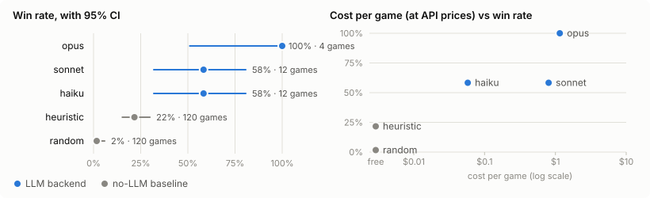

# Benchmark: readme

2026-10-21 · 268 games (268 planned) · Master Rule 3 · 1h47m of play · $14.93 at API prices

> A small-sample pilot: 3 games per (deck, model, opponent) for Haiku and Sonnet and 1 for Opus, so the 95% intervals are wide and the ordering between the Claude models isn't settled. Opus played only game 1 of each pairing, where the AI seat goes first; the like-for-like table compares every backend on those same games. The baselines play 30 games per pairing. The run is resumable: raise the counts in bench/configs/readme.toml and `ygo-agent bench readme --resume` plays only the new games, on the same seeds.

## Leaderboard

| # | Backend | Model | Games | W-L-D | Win rate (95% CI) | Rating | Going first / second | Avg turns |
|---:|---|---|---:|---:|---|---:|---:|---:|
| 1 | opus | `claude-opus-5-5` | 4 | 4-0-0 | **100%** (51%–100%) | 1845 | 4/4 · – | 3.8 |
| 2 | sonnet | `claude-sonnet-5-5` | 12 | 7-5-0 | **58%** (32%–81%) | 1597 | 5/8 · 2/4 | 7.7 |
| 3 | haiku | `claude-haiku-5-5` | 12 | 7-5-0 | **58%** (32%–81%) | 1597 | 4/8 · 3/4 | 6.2 |
| 4 | heuristic *(baseline)* | no model | 120 | 26-94-0 | **22%** (15%–30%) | 1282 | 15/60 · 11/60 | 7.6 |
| 5 | random *(baseline)* | no model | 120 | 2-118-0 | **2%** (0%–6%) | 838 | 0/60 · 2/60 | 7.4 |

| Backend | Time per game | Decision latency mean · p50 · p95 | Tokens per game: in · out · cache read | Cost per game | Invalid replies | Fallbacks | Rule-answered | Errors (timeouts) |
|---|---:|---:|---:|---:|---:|---:|---:|---:|
| opus | 2m51s | 3.57s · 2.73s · 7.53s | 93 · 10.6k · 1.18M | $1.15 | 0.0% (0/186) | 0.0% | 0.9% | 0 (0) |
| sonnet | 3m05s | 2.42s · 1.86s · 5.53s | 145 · 13.0k · 1.86M | $0.80 | 0.0% (0/871) | 0.0% | 7.2% | 0 (0) |
| haiku | 3m03s | 2.79s · 1.56s · 9.04s | 126 · 30.5k · 1.88M | $0.058 | 0.0% (0/754) | 0.0% | 5.5% | 0 (0) |
| heuristic | 5.8s | – | – | free | – | 0.0% | 3.2% | 0 (0) |
| random | 5.5s | – | – | free | – | 0.0% | 4.0% | 0 (0) |

### Like for like

The 4 games every backend played (game 1 of each deck × opponent pairing: the same seeds and the same player going first for everyone):

| Backend | Games | Wins | Win rate (95% CI) |
|---|---:|---:|---|
| opus | 4 | 4 | **100%** (51%–100%) |
| sonnet | 4 | 3 | **75%** (30%–95%) |
| haiku | 4 | 1 | **25%** (5%–70%) |
| heuristic | 4 | 1 | **25%** (5%–70%) |
| random | 4 | 0 | **0%** (0%–49%) |

## Wins by matchup

| Backend | blackwing vs Blue-Eyes | blackwing vs Time Thief | saffira vs Blue-Eyes | saffira vs Time Thief |
|---|---:|---:|---:|---:|
| opus | 1/1 | 1/1 | 1/1 | 1/1 |
| sonnet | 0/3 | 3/3 | 1/3 | 3/3 |
| haiku | 0/3 | 2/3 | 2/3 | 3/3 |
| heuristic | 2/30 | 9/30 | 3/30 | 12/30 |
| random | 0/30 | 0/30 | 0/30 | 2/30 |

## Matchups

| Deck | Backend | Opponent | Games | W-L-D | Win rate (95% CI) | Avg turns | Time per game | Latency p50 · p95 | Cost per game | Invalid | Fallbacks |
|---|---|---|---:|---:|---|---:|---:|---:|---:|---:|---:|
| blackwing | opus | Blue-Eyes (WindBot) | 1 | 1-0-0 | **100%** (21%–100%) | 3.0 | 2m20s | 2.33s · 6.96s | $0.99 | 0.0% | 0.0% |
| blackwing | sonnet | Blue-Eyes (WindBot) | 3 | 0-3-0 | **0%** (0%–56%) | 8.3 | 2m46s | 1.87s · 5.97s | $0.76 | 0.0% | 0.0% |
| blackwing | haiku | Blue-Eyes (WindBot) | 3 | 0-3-0 | **0%** (0%–56%) | 6.3 | 3m20s | 1.71s · 11.6s | $0.061 | 0.0% | 0.0% |
| blackwing | heuristic | Blue-Eyes (WindBot) | 30 | 2-28-0 | **7%** (2%–21%) | 5.5 | 5.1s | – | free | – | 0.0% |
| blackwing | random | Blue-Eyes (WindBot) | 30 | 0-30-0 | **0%** (0%–11%) | 5.1 | 4.5s | – | free | – | 0.0% |
| blackwing | opus | Time Thief (WindBot) | 1 | 1-0-0 | **100%** (21%–100%) | 4.0 | 2m55s | 3.05s · 7.34s | $1.16 | 0.0% | 0.0% |
| blackwing | sonnet | Time Thief (WindBot) | 3 | 3-0-0 | **100%** (44%–100%) | 6.7 | 3m02s | 1.82s · 5.72s | $0.84 | 0.0% | 0.0% |
| blackwing | haiku | Time Thief (WindBot) | 3 | 2-1-0 | **67%** (21%–94%) | 7.7 | 3m11s | 1.65s · 9.38s | $0.060 | 0.0% | 0.0% |
| blackwing | heuristic | Time Thief (WindBot) | 30 | 9-21-0 | **30%** (17%–48%) | 9.2 | 6.4s | – | free | – | 0.0% |
| blackwing | random | Time Thief (WindBot) | 30 | 0-30-0 | **0%** (0%–11%) | 9.9 | 6.8s | – | free | – | 0.0% |
| saffira | opus | Blue-Eyes (WindBot) | 1 | 1-0-0 | **100%** (21%–100%) | 5.0 | 4m07s | 3.11s · 10.3s | $1.61 | 0.0% | 0.0% |
| saffira | sonnet | Blue-Eyes (WindBot) | 3 | 1-2-0 | **33%** (6%–79%) | 7.0 | 2m51s | 1.87s · 5.84s | $0.70 | 0.0% | 0.0% |
| saffira | haiku | Blue-Eyes (WindBot) | 3 | 2-1-0 | **67%** (21%–94%) | 6.0 | 2m48s | 1.71s · 6.75s | $0.051 | 0.0% | 0.0% |
| saffira | heuristic | Blue-Eyes (WindBot) | 30 | 3-27-0 | **10%** (3%–26%) | 6.6 | 5.7s | – | free | – | 0.0% |
| saffira | random | Blue-Eyes (WindBot) | 30 | 0-30-0 | **0%** (0%–11%) | 4.8 | 4.3s | – | free | – | 0.0% |
| saffira | opus | Time Thief (WindBot) | 1 | 1-0-0 | **100%** (21%–100%) | 3.0 | 2m04s | 2.16s · 10.1s | $0.85 | 0.0% | 0.0% |
| saffira | sonnet | Time Thief (WindBot) | 3 | 3-0-0 | **100%** (44%–100%) | 8.7 | 3m40s | 1.86s · 4.72s | $0.91 | 0.0% | 0.0% |
| saffira | haiku | Time Thief (WindBot) | 3 | 3-0-0 | **100%** (44%–100%) | 5.0 | 2m54s | 1.31s · 7.18s | $0.060 | 0.0% | 0.0% |
| saffira | heuristic | Time Thief (WindBot) | 30 | 12-18-0 | **40%** (25%–58%) | 9.1 | 6.2s | – | free | – | 0.0% |
| saffira | random | Time Thief (WindBot) | 30 | 2-28-0 | **7%** (2%–21%) | 9.7 | 6.6s | – | free | – | 0.0% |

## Opponents

| Opponent | WindBot difficulty | Games | AI seat's wins | Rating |
|---|---:|---:|---:|---:|
| Blue-Eyes (WindBot) | 2 | 134 | 10 (7%) | 1711 |
| Time Thief (WindBot) | 2 | 134 | 36 (27%) | 1379 |

## Notes

- **Plan:** decks saffira, blackwing; backends opus, sonnet, haiku, heuristic, random; opponents Blue-Eyes (WindBot), Time Thief (WindBot). 3 games per (deck, backend, opponent), except opus 1, heuristic 30, random 30.
- **Seeds:** game *i* of every pairing uses seed 1000 + *i*, and the AI seat goes first in odd-numbered games and second in even ones, so every backend gets the same deals in the same order.
- **Status:** 268 of 268 planned games finished.
- **Rules:** Master Rule 3 (duel flags 0xd1800), Bo1, 8000 LP.
- **Engine:** ygopro-core 11.0 (`~/Games/ProjectIgnis/repositories/delta-bagooska/bin/libocgcore.so`), card scripts as of 2026-10-21, 24932 cards from 21 databases (newest 2026-10-21).
- **Deck Saffira:** 40 main / 12 extra (`~/Games/ProjectIgnis/deck/Saffira.ydk`, sha 555aa649b67d); playbook 9362 chars (sha 472d46ae1130), hard rules: 2.
- **Deck Blackwing:** 40 main / 15 extra (`~/Games/ProjectIgnis/deck/Blackwing.ydk`, sha 56162bd7d5f9); playbook 13331 chars (sha 82473112a47b), hard rules: 1.
- **Opponent Blue-Eyes (WindBot):** WindBot deck AI `Blue-Eyes`, difficulty 2 (the repo fork, deck sha 592c765a1075).
- **Opponent Time Thief (WindBot):** WindBot deck AI `TimeThief`, difficulty 2 (the repo fork, deck sha 81c074c6bba6).
- **Backend opus:** type claude-code, model opus, effort medium, model id claude-opus-5-5.
- **Backend sonnet:** type claude-code, model sonnet, effort medium, model id claude-sonnet-5-5.
- **Backend haiku:** type claude-code, model haiku, effort medium, model id claude-haiku-5-5.
- **Backend heuristic:** type heuristic.
- **Backend random:** type random.
- **Claude Code CLI:** 2.1.306 (Claude Code). Its cost figure is what the tokens would cost at API prices; a subscription login isn't billed per call.
- **Software:** ygo-agent 0.1.0, Python 3.14.6.
- **Metrics:** win rate = wins / games (draws count as not won), with a Wilson 95% interval. Rating: Bradley-Terry on the Elo scale over every game (backends and opponents as players), each with one virtual win and loss against a 1500-rated anchor, so it accounts for opponent strength and stays finite at 0 or 100%. Latency: backend seconds per decision it was asked (re-asks included). Invalid replies: model outputs that couldn't be read or named an illegal option (the agent re-asks once). Fallbacks: decisions the heuristic answered because the backend didn't (timeout, error, two invalid replies). Rule-answered: decisions the deck's hard rules made. Turns count both players' turns.

## Games

Every game, with its EDOPro replay (open it in EDOPro's replay menu)

| Deck | Backend | Opponent | Game | Seed | First | Result | Turns | Time | Replay |
|---|---|---|---:|---:|---|---|---:|---:|---|
| blackwing | haiku | Blue-Eyes (WindBot) | 1 | 1000 | AI seat | loss | 4 | 1m37s | [replay](replays/blackwing--haiku--windbot-blue-eyes--001.yrpX) |
| blackwing | haiku | Blue-Eyes (WindBot) | 2 | 1001 | opponent | loss | 9 | 4m56s | [replay](replays/blackwing--haiku--windbot-blue-eyes--002.yrpX) |
| blackwing | haiku | Blue-Eyes (WindBot) | 3 | 1002 | AI seat | loss | 6 | 3m26s | [replay](replays/blackwing--haiku--windbot-blue-eyes--003.yrpX) |
| blackwing | heuristic | Blue-Eyes (WindBot) | 1 | 1000 | AI seat | loss | 4 | 5.6s | [replay](replays/blackwing--heuristic--windbot-blue-eyes--001.yrpX) |
| blackwing | heuristic | Blue-Eyes (WindBot) | 2 | 1001 | opponent | loss | 11 | 5.7s | [replay](replays/blackwing--heuristic--windbot-blue-eyes--002.yrpX) |
| blackwing | heuristic | Blue-Eyes (WindBot) | 3 | 1002 | AI seat | loss | 8 | 6.4s | [replay](replays/blackwing--heuristic--windbot-blue-eyes--003.yrpX) |
| blackwing | heuristic | Blue-Eyes (WindBot) | 4 | 1003 | opponent | loss | 5 | 6.0s | [replay](replays/blackwing--heuristic--windbot-blue-eyes--004.yrpX) |
| blackwing | heuristic | Blue-Eyes (WindBot) | 5 | 1004 | AI seat | loss | 4 | 5.4s | [replay](replays/blackwing--heuristic--windbot-blue-eyes--005.yrpX) |
| blackwing | heuristic | Blue-Eyes (WindBot) | 6 | 1005 | opponent | loss | 3 | 3.3s | [replay](replays/blackwing--heuristic--windbot-blue-eyes--006.yrpX) |
| blackwing | heuristic | Blue-Eyes (WindBot) | 7 | 1006 | AI seat | loss | 8 | 5.9s | [replay](replays/blackwing--heuristic--windbot-blue-eyes--007.yrpX) |
| blackwing | heuristic | Blue-Eyes (WindBot) | 8 | 1007 | opponent | loss | 3 | 3.9s | [replay](replays/blackwing--heuristic--windbot-blue-eyes--008.yrpX) |
| blackwing | heuristic | Blue-Eyes (WindBot) | 9 | 1008 | AI seat | loss | 4 | 4.2s | [replay](replays/blackwing--heuristic--windbot-blue-eyes--009.yrpX) |
| blackwing | heuristic | Blue-Eyes (WindBot) | 10 | 1009 | opponent | loss | 9 | 6.0s | [replay](replays/blackwing--heuristic--windbot-blue-eyes--010.yrpX) |
| blackwing | heuristic | Blue-Eyes (WindBot) | 11 | 1010 | AI seat | loss | 8 | 7.8s | [replay](replays/blackwing--heuristic--windbot-blue-eyes--011.yrpX) |
| blackwing | heuristic | Blue-Eyes (WindBot) | 12 | 1011 | opponent | loss | 3 | 5.1s | [replay](replays/blackwing--heuristic--windbot-blue-eyes--012.yrpX) |
| blackwing | heuristic | Blue-Eyes (WindBot) | 13 | 1012 | AI seat | loss | 12 | 8.3s | [replay](replays/blackwing--heuristic--windbot-blue-eyes--013.yrpX) |
| blackwing | heuristic | Blue-Eyes (WindBot) | 14 | 1013 | opponent | loss | 7 | 6.4s | [replay](replays/blackwing--heuristic--windbot-blue-eyes--014.yrpX) |
| blackwing | heuristic | Blue-Eyes (WindBot) | 15 | 1014 | AI seat | loss | 6 | 7.1s | [replay](replays/blackwing--heuristic--windbot-blue-eyes--015.yrpX) |
| blackwing | heuristic | Blue-Eyes (WindBot) | 16 | 1015 | opponent | loss | 5 | 3.9s | [replay](replays/blackwing--heuristic--windbot-blue-eyes--016.yrpX) |
| blackwing | heuristic | Blue-Eyes (WindBot) | 17 | 1016 | AI seat | loss | 6 | 6.3s | [replay](replays/blackwing--heuristic--windbot-blue-eyes--017.yrpX) |
| blackwing | heuristic | Blue-Eyes (WindBot) | 18 | 1017 | opponent | loss | 3 | 3.8s | [replay](replays/blackwing--heuristic--windbot-blue-eyes--018.yrpX) |
| blackwing | heuristic | Blue-Eyes (WindBot) | 19 | 1018 | AI seat | loss | 6 | 5.5s | [replay](replays/blackwing--heuristic--windbot-blue-eyes--019.yrpX) |
| blackwing | heuristic | Blue-Eyes (WindBot) | 20 | 1019 | opponent | loss | 5 | 4.8s | [replay](replays/blackwing--heuristic--windbot-blue-eyes--020.yrpX) |
| blackwing | heuristic | Blue-Eyes (WindBot) | 21 | 1020 | AI seat | loss | 4 | 3.9s | [replay](replays/blackwing--heuristic--windbot-blue-eyes--021.yrpX) |
| blackwing | heuristic | Blue-Eyes (WindBot) | 22 | 1021 | opponent | win | 5 | 3.0s | [replay](replays/blackwing--heuristic--windbot-blue-eyes--022.yrpX) |
| blackwing | heuristic | Blue-Eyes (WindBot) | 23 | 1022 | AI seat | loss | 4 | 6.0s | [replay](replays/blackwing--heuristic--windbot-blue-eyes--023.yrpX) |
| blackwing | heuristic | Blue-Eyes (WindBot) | 24 | 1023 | opponent | loss | 7 | 5.2s | [replay](replays/blackwing--heuristic--windbot-blue-eyes--024.yrpX) |
| blackwing | heuristic | Blue-Eyes (WindBot) | 25 | 1024 | AI seat | loss | 4 | 4.1s | [replay](replays/blackwing--heuristic--windbot-blue-eyes--025.yrpX) |
| blackwing | heuristic | Blue-Eyes (WindBot) | 26 | 1025 | opponent | loss | 7 | 3.9s | [replay](replays/blackwing--heuristic--windbot-blue-eyes--026.yrpX) |
| blackwing | heuristic | Blue-Eyes (WindBot) | 27 | 1026 | AI seat | loss | 4 | 4.0s | [replay](replays/blackwing--heuristic--windbot-blue-eyes--027.yrpX) |
| blackwing | heuristic | Blue-Eyes (WindBot) | 28 | 1027 | opponent | win | 4 | 4.3s | [replay](replays/blackwing--heuristic--windbot-blue-eyes--028.yrpX) |
| blackwing | heuristic | Blue-Eyes (WindBot) | 29 | 1028 | AI seat | loss | 3 | 2.8s | [replay](replays/blackwing--heuristic--windbot-blue-eyes--029.yrpX) |
| blackwing | heuristic | Blue-Eyes (WindBot) | 30 | 1029 | opponent | loss | 3 | 4.5s | [replay](replays/blackwing--heuristic--windbot-blue-eyes--030.yrpX) |
| blackwing | opus | Blue-Eyes (WindBot) | 1 | 1000 | AI seat | win | 3 | 2m20s | [replay](replays/blackwing--opus--windbot-blue-eyes--001.yrpX) |
| blackwing | random | Blue-Eyes (WindBot) | 1 | 1000 | AI seat | loss | 2 | 2.8s | [replay](replays/blackwing--random--windbot-blue-eyes--001.yrpX) |
| blackwing | random | Blue-Eyes (WindBot) | 2 | 1001 | opponent | loss | 7 | 3.2s | [replay](replays/blackwing--random--windbot-blue-eyes--002.yrpX) |
| blackwing | random | Blue-Eyes (WindBot) | 3 | 1002 | AI seat | loss | 6 | 4.8s | [replay](replays/blackwing--random--windbot-blue-eyes--003.yrpX) |
| blackwing | random | Blue-Eyes (WindBot) | 4 | 1003 | opponent | loss | 3 | 3.4s | [replay](replays/blackwing--random--windbot-blue-eyes--004.yrpX) |
| blackwing | random | Blue-Eyes (WindBot) | 5 | 1004 | AI seat | loss | 4 | 4.8s | [replay](replays/blackwing--random--windbot-blue-eyes--005.yrpX) |
| blackwing | random | Blue-Eyes (WindBot) | 6 | 1005 | opponent | loss | 5 | 5.7s | [replay](replays/blackwing--random--windbot-blue-eyes--006.yrpX) |
| blackwing | random | Blue-Eyes (WindBot) | 7 | 1006 | AI seat | loss | 4 | 4.4s | [replay](replays/blackwing--random--windbot-blue-eyes--007.yrpX) |
| blackwing | random | Blue-Eyes (WindBot) | 8 | 1007 | opponent | loss | 3 | 3.9s | [replay](replays/blackwing--random--windbot-blue-eyes--008.yrpX) |
| blackwing | random | Blue-Eyes (WindBot) | 9 | 1008 | AI seat | loss | 6 | 7.6s | [replay](replays/blackwing--random--windbot-blue-eyes--009.yrpX) |
| blackwing | random | Blue-Eyes (WindBot) | 10 | 1009 | opponent | loss | 4 | 2.2s | [replay](replays/blackwing--random--windbot-blue-eyes--010.yrpX) |
| blackwing | random | Blue-Eyes (WindBot) | 11 | 1010 | AI seat | loss | 6 | 6.1s | [replay](replays/blackwing--random--windbot-blue-eyes--011.yrpX) |
| blackwing | random | Blue-Eyes (WindBot) | 12 | 1011 | opponent | loss | 3 | 4.8s | [replay](replays/blackwing--random--windbot-blue-eyes--012.yrpX) |
| blackwing | random | Blue-Eyes (WindBot) | 13 | 1012 | AI seat | loss | 6 | 4.1s | [replay](replays/blackwing--random--windbot-blue-eyes--013.yrpX) |
| blackwing | random | Blue-Eyes (WindBot) | 14 | 1013 | opponent | loss | 7 | 6.3s | [replay](replays/blackwing--random--windbot-blue-eyes--014.yrpX) |
| blackwing | random | Blue-Eyes (WindBot) | 15 | 1014 | AI seat | loss | 4 | 3.7s | [replay](replays/blackwing--random--windbot-blue-eyes--015.yrpX) |
| blackwing | random | Blue-Eyes (WindBot) | 16 | 1015 | opponent | loss | 7 | 5.4s | [replay](replays/blackwing--random--windbot-blue-eyes--016.yrpX) |
| blackwing | random | Blue-Eyes (WindBot) | 17 | 1016 | AI seat | loss | 6 | 5.7s | [replay](replays/blackwing--random--windbot-blue-eyes--017.yrpX) |
| blackwing | random | Blue-Eyes (WindBot) | 18 | 1017 | opponent | loss | 3 | 4.2s | [replay](replays/blackwing--random--windbot-blue-eyes--018.yrpX) |
| blackwing | random | Blue-Eyes (WindBot) | 19 | 1018 | AI seat | loss | 6 | 5.2s | [replay](replays/blackwing--random--windbot-blue-eyes--019.yrpX) |
| blackwing | random | Blue-Eyes (WindBot) | 20 | 1019 | opponent | loss | 5 | 4.9s | [replay](replays/blackwing--random--windbot-blue-eyes--020.yrpX) |
| blackwing | random | Blue-Eyes (WindBot) | 21 | 1020 | AI seat | loss | 10 | 5.4s | [replay](replays/blackwing--random--windbot-blue-eyes--021.yrpX) |
| blackwing | random | Blue-Eyes (WindBot) | 22 | 1021 | opponent | loss | 7 | 3.3s | [replay](replays/blackwing--random--windbot-blue-eyes--022.yrpX) |
| blackwing | random | Blue-Eyes (WindBot) | 23 | 1022 | AI seat | loss | 4 | 3.1s | [replay](replays/blackwing--random--windbot-blue-eyes--023.yrpX) |
| blackwing | random | Blue-Eyes (WindBot) | 24 | 1023 | opponent | loss | 7 | 4.0s | [replay](replays/blackwing--random--windbot-blue-eyes--024.yrpX) |
| blackwing | random | Blue-Eyes (WindBot) | 25 | 1024 | AI seat | loss | 2 | 4.5s | [replay](replays/blackwing--random--windbot-blue-eyes--025.yrpX) |
| blackwing | random | Blue-Eyes (WindBot) | 26 | 1025 | opponent | loss | 5 | 4.7s | [replay](replays/blackwing--random--windbot-blue-eyes--026.yrpX) |
| blackwing | random | Blue-Eyes (WindBot) | 27 | 1026 | AI seat | loss | 4 | 4.6s | [replay](replays/blackwing--random--windbot-blue-eyes--027.yrpX) |
| blackwing | random | Blue-Eyes (WindBot) | 28 | 1027 | opponent | loss | 7 | 4.7s | [replay](replays/blackwing--random--windbot-blue-eyes--028.yrpX) |
| blackwing | random | Blue-Eyes (WindBot) | 29 | 1028 | AI seat | loss | 6 | 4.9s | [replay](replays/blackwing--random--windbot-blue-eyes--029.yrpX) |
| blackwing | random | Blue-Eyes (WindBot) | 30 | 1029 | opponent | loss | 3 | 3.2s | [replay](replays/blackwing--random--windbot-blue-eyes--030.yrpX) |
| blackwing | sonnet | Blue-Eyes (WindBot) | 1 | 1000 | AI seat | loss | 6 | 2m26s | [replay](replays/blackwing--sonnet--windbot-blue-eyes--001.yrpX) |
| blackwing | sonnet | Blue-Eyes (WindBot) | 2 | 1001 | opponent | loss | 11 | 2m57s | [replay](replays/blackwing--sonnet--windbot-blue-eyes--002.yrpX) |
| blackwing | sonnet | Blue-Eyes (WindBot) | 3 | 1002 | AI seat | loss | 8 | 2m55s | [replay](replays/blackwing--sonnet--windbot-blue-eyes--003.yrpX) |
| blackwing | haiku | Time Thief (WindBot) | 1 | 1000 | AI seat | loss | 8 | 3m00s | [replay](replays/blackwing--haiku--windbot-time-thief--001.yrpX) |
| blackwing | haiku | Time Thief (WindBot) | 2 | 1001 | opponent | win | 8 | 3m03s | [replay](replays/blackwing--haiku--windbot-time-thief--002.yrpX) |
| blackwing | haiku | Time Thief (WindBot) | 3 | 1002 | AI seat | win | 7 | 3m30s | [replay](replays/blackwing--haiku--windbot-time-thief--003.yrpX) |
| blackwing | heuristic | Time Thief (WindBot) | 1 | 1000 | AI seat | win | 5 | 5.8s | [replay](replays/blackwing--heuristic--windbot-time-thief--001.yrpX) |
| blackwing | heuristic | Time Thief (WindBot) | 2 | 1001 | opponent | loss | 9 | 4.1s | [replay](replays/blackwing--heuristic--windbot-time-thief--002.yrpX) |
| blackwing | heuristic | Time Thief (WindBot) | 3 | 1002 | AI seat | win | 5 | 3.8s | [replay](replays/blackwing--heuristic--windbot-time-thief--003.yrpX) |
| blackwing | heuristic | Time Thief (WindBot) | 4 | 1003 | opponent | loss | 13 | 7.0s | [replay](replays/blackwing--heuristic--windbot-time-thief--004.yrpX) |
| blackwing | heuristic | Time Thief (WindBot) | 5 | 1004 | AI seat | loss | 8 | 7.6s | [replay](replays/blackwing--heuristic--windbot-time-thief--005.yrpX) |
| blackwing | heuristic | Time Thief (WindBot) | 6 | 1005 | opponent | loss | 11 | 5.5s | [replay](replays/blackwing--heuristic--windbot-time-thief--006.yrpX) |
| blackwing | heuristic | Time Thief (WindBot) | 7 | 1006 | AI seat | win | 7 | 5.4s | [replay](replays/blackwing--heuristic--windbot-time-thief--007.yrpX) |
| blackwing | heuristic | Time Thief (WindBot) | 8 | 1007 | opponent | win | 6 | 5.4s | [replay](replays/blackwing--heuristic--windbot-time-thief--008.yrpX) |
| blackwing | heuristic | Time Thief (WindBot) | 9 | 1008 | AI seat | win | 15 | 7.3s | [replay](replays/blackwing--heuristic--windbot-time-thief--009.yrpX) |
| blackwing | heuristic | Time Thief (WindBot) | 10 | 1009 | opponent | loss | 11 | 8.1s | [replay](replays/blackwing--heuristic--windbot-time-thief--010.yrpX) |
| blackwing | heuristic | Time Thief (WindBot) | 11 | 1010 | AI seat | loss | 8 | 7.8s | [replay](replays/blackwing--heuristic--windbot-time-thief--011.yrpX) |
| blackwing | heuristic | Time Thief (WindBot) | 12 | 1011 | opponent | loss | 9 | 5.5s | [replay](replays/blackwing--heuristic--windbot-time-thief--012.yrpX) |
| blackwing | heuristic | Time Thief (WindBot) | 13 | 1012 | AI seat | loss | 8 | 8.4s | [replay](replays/blackwing--heuristic--windbot-time-thief--013.yrpX) |
| blackwing | heuristic | Time Thief (WindBot) | 14 | 1013 | opponent | loss | 15 | 9.7s | [replay](replays/blackwing--heuristic--windbot-time-thief--014.yrpX) |
| blackwing | heuristic | Time Thief (WindBot) | 15 | 1014 | AI seat | loss | 12 | 7.9s | [replay](replays/blackwing--heuristic--windbot-time-thief--015.yrpX) |
| blackwing | heuristic | Time Thief (WindBot) | 16 | 1015 | opponent | loss | 19 | 10.3s | [replay](replays/blackwing--heuristic--windbot-time-thief--016.yrpX) |
| blackwing | heuristic | Time Thief (WindBot) | 17 | 1016 | AI seat | win | 5 | 4.6s | [replay](replays/blackwing--heuristic--windbot-time-thief--017.yrpX) |
| blackwing | heuristic | Time Thief (WindBot) | 18 | 1017 | opponent | loss | 13 | 10.8s | [replay](replays/blackwing--heuristic--windbot-time-thief--018.yrpX) |
| blackwing | heuristic | Time Thief (WindBot) | 19 | 1018 | AI seat | loss | 6 | 3.9s | [replay](replays/blackwing--heuristic--windbot-time-thief--019.yrpX) |
| blackwing | heuristic | Time Thief (WindBot) | 20 | 1019 | opponent | win | 6 | 4.8s | [replay](replays/blackwing--heuristic--windbot-time-thief--020.yrpX) |
| blackwing | heuristic | Time Thief (WindBot) | 21 | 1020 | AI seat | loss | 6 | 5.3s | [replay](replays/blackwing--heuristic--windbot-time-thief--021.yrpX) |
| blackwing | heuristic | Time Thief (WindBot) | 22 | 1021 | opponent | loss | 19 | 9.2s | [replay](replays/blackwing--heuristic--windbot-time-thief--022.yrpX) |
| blackwing | heuristic | Time Thief (WindBot) | 23 | 1022 | AI seat | win | 5 | 4.8s | [replay](replays/blackwing--heuristic--windbot-time-thief--023.yrpX) |
| blackwing | heuristic | Time Thief (WindBot) | 24 | 1023 | opponent | loss | 11 | 4.6s | [replay](replays/blackwing--heuristic--windbot-time-thief--024.yrpX) |
| blackwing | heuristic | Time Thief (WindBot) | 25 | 1024 | AI seat | loss | 6 | 5.2s | [replay](replays/blackwing--heuristic--windbot-time-thief--025.yrpX) |
| blackwing | heuristic | Time Thief (WindBot) | 26 | 1025 | opponent | loss | 11 | 9.6s | [replay](replays/blackwing--heuristic--windbot-time-thief--026.yrpX) |
| blackwing | heuristic | Time Thief (WindBot) | 27 | 1026 | AI seat | loss | 4 | 3.7s | [replay](replays/blackwing--heuristic--windbot-time-thief--027.yrpX) |
| blackwing | heuristic | Time Thief (WindBot) | 28 | 1027 | opponent | win | 12 | 5.0s | [replay](replays/blackwing--heuristic--windbot-time-thief--028.yrpX) |
| blackwing | heuristic | Time Thief (WindBot) | 29 | 1028 | AI seat | loss | 6 | 5.2s | [replay](replays/blackwing--heuristic--windbot-time-thief--029.yrpX) |
| blackwing | heuristic | Time Thief (WindBot) | 30 | 1029 | opponent | loss | 5 | 4.4s | [replay](replays/blackwing--heuristic--windbot-time-thief--030.yrpX) |
| blackwing | opus | Time Thief (WindBot) | 1 | 1000 | AI seat | win | 4 | 2m55s | [replay](replays/blackwing--opus--windbot-time-thief--001.yrpX) |
| blackwing | random | Time Thief (WindBot) | 1 | 1000 | AI seat | loss | 8 | 7.4s | [replay](replays/blackwing--random--windbot-time-thief--001.yrpX) |
| blackwing | random | Time Thief (WindBot) | 2 | 1001 | opponent | loss | 7 | 4.6s | [replay](replays/blackwing--random--windbot-time-thief--002.yrpX) |
| blackwing | random | Time Thief (WindBot) | 3 | 1002 | AI seat | loss | 8 | 6.8s | [replay](replays/blackwing--random--windbot-time-thief--003.yrpX) |
| blackwing | random | Time Thief (WindBot) | 4 | 1003 | opponent | loss | 21 | 9.3s | [replay](replays/blackwing--random--windbot-time-thief--004.yrpX) |
| blackwing | random | Time Thief (WindBot) | 5 | 1004 | AI seat | loss | 20 | 12.3s | [replay](replays/blackwing--random--windbot-time-thief--005.yrpX) |
| blackwing | random | Time Thief (WindBot) | 6 | 1005 | opponent | loss | 9 | 6.6s | [replay](replays/blackwing--random--windbot-time-thief--006.yrpX) |
| blackwing | random | Time Thief (WindBot) | 7 | 1006 | AI seat | loss | 8 | 7.4s | [replay](replays/blackwing--random--windbot-time-thief--007.yrpX) |
| blackwing | random | Time Thief (WindBot) | 8 | 1007 | opponent | loss | 21 | 14.7s | [replay](replays/blackwing--random--windbot-time-thief--008.yrpX) |
| blackwing | random | Time Thief (WindBot) | 9 | 1008 | AI seat | loss | 14 | 7.5s | [replay](replays/blackwing--random--windbot-time-thief--009.yrpX) |
| blackwing | random | Time Thief (WindBot) | 10 | 1009 | opponent | loss | 7 | 5.1s | [replay](replays/blackwing--random--windbot-time-thief--010.yrpX) |
| blackwing | random | Time Thief (WindBot) | 11 | 1010 | AI seat | loss | 6 | 4.9s | [replay](replays/blackwing--random--windbot-time-thief--011.yrpX) |
| blackwing | random | Time Thief (WindBot) | 12 | 1011 | opponent | loss | 5 | 4.4s | [replay](replays/blackwing--random--windbot-time-thief--012.yrpX) |
| blackwing | random | Time Thief (WindBot) | 13 | 1012 | AI seat | loss | 6 | 5.8s | [replay](replays/blackwing--random--windbot-time-thief--013.yrpX) |
| blackwing | random | Time Thief (WindBot) | 14 | 1013 | opponent | loss | 9 | 5.7s | [replay](replays/blackwing--random--windbot-time-thief--014.yrpX) |
| blackwing | random | Time Thief (WindBot) | 15 | 1014 | AI seat | loss | 10 | 7.1s | [replay](replays/blackwing--random--windbot-time-thief--015.yrpX) |
| blackwing | random | Time Thief (WindBot) | 16 | 1015 | opponent | loss | 7 | 5.6s | [replay](replays/blackwing--random--windbot-time-thief--016.yrpX) |
| blackwing | random | Time Thief (WindBot) | 17 | 1016 | AI seat | loss | 10 | 5.6s | [replay](replays/blackwing--random--windbot-time-thief--017.yrpX) |
| blackwing | random | Time Thief (WindBot) | 18 | 1017 | opponent | loss | 7 | 5.3s | [replay](replays/blackwing--random--windbot-time-thief--018.yrpX) |
| blackwing | random | Time Thief (WindBot) | 19 | 1018 | AI seat | loss | 10 | 6.7s | [replay](replays/blackwing--random--windbot-time-thief--019.yrpX) |
| blackwing | random | Time Thief (WindBot) | 20 | 1019 | opponent | loss | 7 | 6.5s | [replay](replays/blackwing--random--windbot-time-thief--020.yrpX) |
| blackwing | random | Time Thief (WindBot) | 21 | 1020 | AI seat | loss | 8 | 6.0s | [replay](replays/blackwing--random--windbot-time-thief--021.yrpX) |
| blackwing | random | Time Thief (WindBot) | 22 | 1021 | opponent | loss | 19 | 12.4s | [replay](replays/blackwing--random--windbot-time-thief--022.yrpX) |
| blackwing | random | Time Thief (WindBot) | 23 | 1022 | AI seat | loss | 6 | 4.5s | [replay](replays/blackwing--random--windbot-time-thief--023.yrpX) |
| blackwing | random | Time Thief (WindBot) | 24 | 1023 | opponent | loss | 13 | 6.2s | [replay](replays/blackwing--random--windbot-time-thief--024.yrpX) |
| blackwing | random | Time Thief (WindBot) | 25 | 1024 | AI seat | loss | 4 | 3.9s | [replay](replays/blackwing--random--windbot-time-thief--025.yrpX) |
| blackwing | random | Time Thief (WindBot) | 26 | 1025 | opponent | loss | 7 | 8.2s | [replay](replays/blackwing--random--windbot-time-thief--026.yrpX) |
| blackwing | random | Time Thief (WindBot) | 27 | 1026 | AI seat | loss | 6 | 4.4s | [replay](replays/blackwing--random--windbot-time-thief--027.yrpX) |
| blackwing | random | Time Thief (WindBot) | 28 | 1027 | opponent | loss | 21 | 8.1s | [replay](replays/blackwing--random--windbot-time-thief--028.yrpX) |
| blackwing | random | Time Thief (WindBot) | 29 | 1028 | AI seat | loss | 8 | 6.7s | [replay](replays/blackwing--random--windbot-time-thief--029.yrpX) |
| blackwing | random | Time Thief (WindBot) | 30 | 1029 | opponent | loss | 5 | 4.4s | [replay](replays/blackwing--random--windbot-time-thief--030.yrpX) |
| blackwing | sonnet | Time Thief (WindBot) | 1 | 1000 | AI seat | win | 7 | 2m39s | [replay](replays/blackwing--sonnet--windbot-time-thief--001.yrpX) |
| blackwing | sonnet | Time Thief (WindBot) | 2 | 1001 | opponent | win | 8 | 3m40s | [replay](replays/blackwing--sonnet--windbot-time-thief--002.yrpX) |
| blackwing | sonnet | Time Thief (WindBot) | 3 | 1002 | AI seat | win | 5 | 2m45s | [replay](replays/blackwing--sonnet--windbot-time-thief--003.yrpX) |
| saffira | haiku | Blue-Eyes (WindBot) | 1 | 1000 | AI seat | loss | 6 | 2m13s | [replay](replays/saffira--haiku--windbot-blue-eyes--001.yrpX) |
| saffira | haiku | Blue-Eyes (WindBot) | 2 | 1001 | opponent | win | 7 | 2m59s | [replay](replays/saffira--haiku--windbot-blue-eyes--002.yrpX) |
| saffira | haiku | Blue-Eyes (WindBot) | 3 | 1002 | AI seat | win | 5 | 3m14s | [replay](replays/saffira--haiku--windbot-blue-eyes--003.yrpX) |
| saffira | heuristic | Blue-Eyes (WindBot) | 1 | 1000 | AI seat | loss | 6 | 6.8s | [replay](replays/saffira--heuristic--windbot-blue-eyes--001.yrpX) |
| saffira | heuristic | Blue-Eyes (WindBot) | 2 | 1001 | opponent | loss | 13 | 4.8s | [replay](replays/saffira--heuristic--windbot-blue-eyes--002.yrpX) |
| saffira | heuristic | Blue-Eyes (WindBot) | 3 | 1002 | AI seat | loss | 8 | 6.0s | [replay](replays/saffira--heuristic--windbot-blue-eyes--003.yrpX) |
| saffira | heuristic | Blue-Eyes (WindBot) | 4 | 1003 | opponent | loss | 5 | 7.2s | [replay](replays/saffira--heuristic--windbot-blue-eyes--004.yrpX) |
| saffira | heuristic | Blue-Eyes (WindBot) | 5 | 1004 | AI seat | loss | 8 | 8.1s | [replay](replays/saffira--heuristic--windbot-blue-eyes--005.yrpX) |
| saffira | heuristic | Blue-Eyes (WindBot) | 6 | 1005 | opponent | loss | 5 | 5.2s | [replay](replays/saffira--heuristic--windbot-blue-eyes--006.yrpX) |
| saffira | heuristic | Blue-Eyes (WindBot) | 7 | 1006 | AI seat | loss | 8 | 5.3s | [replay](replays/saffira--heuristic--windbot-blue-eyes--007.yrpX) |
| saffira | heuristic | Blue-Eyes (WindBot) | 8 | 1007 | opponent | loss | 3 | 4.1s | [replay](replays/saffira--heuristic--windbot-blue-eyes--008.yrpX) |
| saffira | heuristic | Blue-Eyes (WindBot) | 9 | 1008 | AI seat | loss | 4 | 4.1s | [replay](replays/saffira--heuristic--windbot-blue-eyes--009.yrpX) |
| saffira | heuristic | Blue-Eyes (WindBot) | 10 | 1009 | opponent | loss | 7 | 4.6s | [replay](replays/saffira--heuristic--windbot-blue-eyes--010.yrpX) |
| saffira | heuristic | Blue-Eyes (WindBot) | 11 | 1010 | AI seat | loss | 6 | 5.4s | [replay](replays/saffira--heuristic--windbot-blue-eyes--011.yrpX) |
| saffira | heuristic | Blue-Eyes (WindBot) | 12 | 1011 | opponent | loss | 11 | 10.3s | [replay](replays/saffira--heuristic--windbot-blue-eyes--012.yrpX) |
| saffira | heuristic | Blue-Eyes (WindBot) | 13 | 1012 | AI seat | win | 7 | 3.4s | [replay](replays/saffira--heuristic--windbot-blue-eyes--013.yrpX) |
| saffira | heuristic | Blue-Eyes (WindBot) | 14 | 1013 | opponent | win | 4 | 2.0s | [replay](replays/saffira--heuristic--windbot-blue-eyes--014.yrpX) |
| saffira | heuristic | Blue-Eyes (WindBot) | 15 | 1014 | AI seat | loss | 6 | 4.5s | [replay](replays/saffira--heuristic--windbot-blue-eyes--015.yrpX) |
| saffira | heuristic | Blue-Eyes (WindBot) | 16 | 1015 | opponent | loss | 7 | 5.2s | [replay](replays/saffira--heuristic--windbot-blue-eyes--016.yrpX) |
| saffira | heuristic | Blue-Eyes (WindBot) | 17 | 1016 | AI seat | loss | 6 | 5.1s | [replay](replays/saffira--heuristic--windbot-blue-eyes--017.yrpX) |
| saffira | heuristic | Blue-Eyes (WindBot) | 18 | 1017 | opponent | loss | 5 | 6.2s | [replay](replays/saffira--heuristic--windbot-blue-eyes--018.yrpX) |
| saffira | heuristic | Blue-Eyes (WindBot) | 19 | 1018 | AI seat | loss | 4 | 4.5s | [replay](replays/saffira--heuristic--windbot-blue-eyes--019.yrpX) |
| saffira | heuristic | Blue-Eyes (WindBot) | 20 | 1019 | opponent | loss | 5 | 6.3s | [replay](replays/saffira--heuristic--windbot-blue-eyes--020.yrpX) |
| saffira | heuristic | Blue-Eyes (WindBot) | 21 | 1020 | AI seat | loss | 6 | 5.2s | [replay](replays/saffira--heuristic--windbot-blue-eyes--021.yrpX) |
| saffira | heuristic | Blue-Eyes (WindBot) | 22 | 1021 | opponent | win | 8 | 7.3s | [replay](replays/saffira--heuristic--windbot-blue-eyes--022.yrpX) |
| saffira | heuristic | Blue-Eyes (WindBot) | 23 | 1022 | AI seat | loss | 8 | 6.6s | [replay](replays/saffira--heuristic--windbot-blue-eyes--023.yrpX) |
| saffira | heuristic | Blue-Eyes (WindBot) | 24 | 1023 | opponent | loss | 7 | 7.9s | [replay](replays/saffira--heuristic--windbot-blue-eyes--024.yrpX) |
| saffira | heuristic | Blue-Eyes (WindBot) | 25 | 1024 | AI seat | loss | 4 | 3.9s | [replay](replays/saffira--heuristic--windbot-blue-eyes--025.yrpX) |
| saffira | heuristic | Blue-Eyes (WindBot) | 26 | 1025 | opponent | loss | 13 | 8.4s | [replay](replays/saffira--heuristic--windbot-blue-eyes--026.yrpX) |
| saffira | heuristic | Blue-Eyes (WindBot) | 27 | 1026 | AI seat | loss | 6 | 6.1s | [replay](replays/saffira--heuristic--windbot-blue-eyes--027.yrpX) |
| saffira | heuristic | Blue-Eyes (WindBot) | 28 | 1027 | opponent | loss | 7 | 7.2s | [replay](replays/saffira--heuristic--windbot-blue-eyes--028.yrpX) |
| saffira | heuristic | Blue-Eyes (WindBot) | 29 | 1028 | AI seat | loss | 6 | 3.6s | [replay](replays/saffira--heuristic--windbot-blue-eyes--029.yrpX) |
| saffira | heuristic | Blue-Eyes (WindBot) | 30 | 1029 | opponent | loss | 5 | 4.7s | [replay](replays/saffira--heuristic--windbot-blue-eyes--030.yrpX) |
| saffira | opus | Blue-Eyes (WindBot) | 1 | 1000 | AI seat | win | 5 | 4m07s | [replay](replays/saffira--opus--windbot-blue-eyes--001.yrpX) |
| saffira | random | Blue-Eyes (WindBot) | 1 | 1000 | AI seat | loss | 2 | 2.8s | [replay](replays/saffira--random--windbot-blue-eyes--001.yrpX) |
| saffira | random | Blue-Eyes (WindBot) | 2 | 1001 | opponent | loss | 5 | 2.9s | [replay](replays/saffira--random--windbot-blue-eyes--002.yrpX) |
| saffira | random | Blue-Eyes (WindBot) | 3 | 1002 | AI seat | loss | 4 | 1.9s | [replay](replays/saffira--random--windbot-blue-eyes--003.yrpX) |
| saffira | random | Blue-Eyes (WindBot) | 4 | 1003 | opponent | loss | 3 | 3.7s | [replay](replays/saffira--random--windbot-blue-eyes--004.yrpX) |
| saffira | random | Blue-Eyes (WindBot) | 5 | 1004 | AI seat | loss | 4 | 4.5s | [replay](replays/saffira--random--windbot-blue-eyes--005.yrpX) |
| saffira | random | Blue-Eyes (WindBot) | 6 | 1005 | opponent | loss | 5 | 5.6s | [replay](replays/saffira--random--windbot-blue-eyes--006.yrpX) |
| saffira | random | Blue-Eyes (WindBot) | 7 | 1006 | AI seat | loss | 6 | 5.8s | [replay](replays/saffira--random--windbot-blue-eyes--007.yrpX) |
| saffira | random | Blue-Eyes (WindBot) | 8 | 1007 | opponent | loss | 3 | 3.6s | [replay](replays/saffira--random--windbot-blue-eyes--008.yrpX) |
| saffira | random | Blue-Eyes (WindBot) | 9 | 1008 | AI seat | loss | 4 | 4.0s | [replay](replays/saffira--random--windbot-blue-eyes--009.yrpX) |
| saffira | random | Blue-Eyes (WindBot) | 10 | 1009 | opponent | loss | 7 | 4.3s | [replay](replays/saffira--random--windbot-blue-eyes--010.yrpX) |
| saffira | random | Blue-Eyes (WindBot) | 11 | 1010 | AI seat | loss | 4 | 2.8s | [replay](replays/saffira--random--windbot-blue-eyes--011.yrpX) |
| saffira | random | Blue-Eyes (WindBot) | 12 | 1011 | opponent | loss | 3 | 4.0s | [replay](replays/saffira--random--windbot-blue-eyes--012.yrpX) |
| saffira | random | Blue-Eyes (WindBot) | 13 | 1012 | AI seat | loss | 6 | 3.9s | [replay](replays/saffira--random--windbot-blue-eyes--013.yrpX) |
| saffira | random | Blue-Eyes (WindBot) | 14 | 1013 | opponent | loss | 7 | 6.6s | [replay](replays/saffira--random--windbot-blue-eyes--014.yrpX) |
| saffira | random | Blue-Eyes (WindBot) | 15 | 1014 | AI seat | loss | 6 | 4.2s | [replay](replays/saffira--random--windbot-blue-eyes--015.yrpX) |
| saffira | random | Blue-Eyes (WindBot) | 16 | 1015 | opponent | loss | 5 | 3.7s | [replay](replays/saffira--random--windbot-blue-eyes--016.yrpX) |
| saffira | random | Blue-Eyes (WindBot) | 17 | 1016 | AI seat | loss | 6 | 5.2s | [replay](replays/saffira--random--windbot-blue-eyes--017.yrpX) |
| saffira | random | Blue-Eyes (WindBot) | 18 | 1017 | opponent | loss | 3 | 3.7s | [replay](replays/saffira--random--windbot-blue-eyes--018.yrpX) |
| saffira | random | Blue-Eyes (WindBot) | 19 | 1018 | AI seat | loss | 4 | 4.9s | [replay](replays/saffira--random--windbot-blue-eyes--019.yrpX) |
| saffira | random | Blue-Eyes (WindBot) | 20 | 1019 | opponent | loss | 5 | 6.7s | [replay](replays/saffira--random--windbot-blue-eyes--020.yrpX) |
| saffira | random | Blue-Eyes (WindBot) | 21 | 1020 | AI seat | loss | 4 | 3.7s | [replay](replays/saffira--random--windbot-blue-eyes--021.yrpX) |
| saffira | random | Blue-Eyes (WindBot) | 22 | 1021 | opponent | loss | 7 | 4.5s | [replay](replays/saffira--random--windbot-blue-eyes--022.yrpX) |
| saffira | random | Blue-Eyes (WindBot) | 23 | 1022 | AI seat | loss | 4 | 3.4s | [replay](replays/saffira--random--windbot-blue-eyes--023.yrpX) |
| saffira | random | Blue-Eyes (WindBot) | 24 | 1023 | opponent | loss | 7 | 3.7s | [replay](replays/saffira--random--windbot-blue-eyes--024.yrpX) |
| saffira | random | Blue-Eyes (WindBot) | 25 | 1024 | AI seat | loss | 4 | 5.5s | [replay](replays/saffira--random--windbot-blue-eyes--025.yrpX) |
| saffira | random | Blue-Eyes (WindBot) | 26 | 1025 | opponent | loss | 7 | 4.7s | [replay](replays/saffira--random--windbot-blue-eyes--026.yrpX) |
| saffira | random | Blue-Eyes (WindBot) | 27 | 1026 | AI seat | loss | 4 | 4.2s | [replay](replays/saffira--random--windbot-blue-eyes--027.yrpX) |
| saffira | random | Blue-Eyes (WindBot) | 28 | 1027 | opponent | loss | 5 | 5.5s | [replay](replays/saffira--random--windbot-blue-eyes--028.yrpX) |
| saffira | random | Blue-Eyes (WindBot) | 29 | 1028 | AI seat | loss | 6 | 4.9s | [replay](replays/saffira--random--windbot-blue-eyes--029.yrpX) |
| saffira | random | Blue-Eyes (WindBot) | 30 | 1029 | opponent | loss | 3 | 3.8s | [replay](replays/saffira--random--windbot-blue-eyes--030.yrpX) |
| saffira | sonnet | Blue-Eyes (WindBot) | 1 | 1000 | AI seat | win | 6 | 2m35s | [replay](replays/saffira--sonnet--windbot-blue-eyes--001.yrpX) |
| saffira | sonnet | Blue-Eyes (WindBot) | 2 | 1001 | opponent | loss | 9 | 3m26s | [replay](replays/saffira--sonnet--windbot-blue-eyes--002.yrpX) |
| saffira | sonnet | Blue-Eyes (WindBot) | 3 | 1002 | AI seat | loss | 6 | 2m33s | [replay](replays/saffira--sonnet--windbot-blue-eyes--003.yrpX) |
| saffira | haiku | Time Thief (WindBot) | 1 | 1000 | AI seat | win | 7 | 4m12s | [replay](replays/saffira--haiku--windbot-time-thief--001.yrpX) |
| saffira | haiku | Time Thief (WindBot) | 2 | 1001 | opponent | win | 5 | 1m54s | [replay](replays/saffira--haiku--windbot-time-thief--002.yrpX) |
| saffira | haiku | Time Thief (WindBot) | 3 | 1002 | AI seat | win | 3 | 2m35s | [replay](replays/saffira--haiku--windbot-time-thief--003.yrpX) |
| saffira | heuristic | Time Thief (WindBot) | 1 | 1000 | AI seat | loss | 8 | 6.4s | [replay](replays/saffira--heuristic--windbot-time-thief--001.yrpX) |
| saffira | heuristic | Time Thief (WindBot) | 2 | 1001 | opponent | loss | 9 | 5.6s | [replay](replays/saffira--heuristic--windbot-time-thief--002.yrpX) |
| saffira | heuristic | Time Thief (WindBot) | 3 | 1002 | AI seat | win | 7 | 5.2s | [replay](replays/saffira--heuristic--windbot-time-thief--003.yrpX) |
| saffira | heuristic | Time Thief (WindBot) | 4 | 1003 | opponent | loss | 13 | 6.1s | [replay](replays/saffira--heuristic--windbot-time-thief--004.yrpX) |
| saffira | heuristic | Time Thief (WindBot) | 5 | 1004 | AI seat | win | 5 | 4.2s | [replay](replays/saffira--heuristic--windbot-time-thief--005.yrpX) |
| saffira | heuristic | Time Thief (WindBot) | 6 | 1005 | opponent | loss | 7 | 6.0s | [replay](replays/saffira--heuristic--windbot-time-thief--006.yrpX) |
| saffira | heuristic | Time Thief (WindBot) | 7 | 1006 | AI seat | win | 17 | 10.3s | [replay](replays/saffira--heuristic--windbot-time-thief--007.yrpX) |
| saffira | heuristic | Time Thief (WindBot) | 8 | 1007 | opponent | loss | 7 | 5.0s | [replay](replays/saffira--heuristic--windbot-time-thief--008.yrpX) |
| saffira | heuristic | Time Thief (WindBot) | 9 | 1008 | AI seat | win | 9 | 3.7s | [replay](replays/saffira--heuristic--windbot-time-thief--009.yrpX) |
| saffira | heuristic | Time Thief (WindBot) | 10 | 1009 | opponent | loss | 7 | 4.0s | [replay](replays/saffira--heuristic--windbot-time-thief--010.yrpX) |
| saffira | heuristic | Time Thief (WindBot) | 11 | 1010 | AI seat | loss | 10 | 9.0s | [replay](replays/saffira--heuristic--windbot-time-thief--011.yrpX) |
| saffira | heuristic | Time Thief (WindBot) | 12 | 1011 | opponent | loss | 5 | 4.6s | [replay](replays/saffira--heuristic--windbot-time-thief--012.yrpX) |
| saffira | heuristic | Time Thief (WindBot) | 13 | 1012 | AI seat | win | 9 | 8.0s | [replay](replays/saffira--heuristic--windbot-time-thief--013.yrpX) |
| saffira | heuristic | Time Thief (WindBot) | 14 | 1013 | opponent | win | 14 | 7.2s | [replay](replays/saffira--heuristic--windbot-time-thief--014.yrpX) |
| saffira | heuristic | Time Thief (WindBot) | 15 | 1014 | AI seat | loss | 18 | 9.9s | [replay](replays/saffira--heuristic--windbot-time-thief--015.yrpX) |
| saffira | heuristic | Time Thief (WindBot) | 16 | 1015 | opponent | loss | 5 | 4.9s | [replay](replays/saffira--heuristic--windbot-time-thief--016.yrpX) |
| saffira | heuristic | Time Thief (WindBot) | 17 | 1016 | AI seat | win | 9 | 4.2s | [replay](replays/saffira--heuristic--windbot-time-thief--017.yrpX) |
| saffira | heuristic | Time Thief (WindBot) | 18 | 1017 | opponent | loss | 7 | 4.9s | [replay](replays/saffira--heuristic--windbot-time-thief--018.yrpX) |
| saffira | heuristic | Time Thief (WindBot) | 19 | 1018 | AI seat | loss | 8 | 4.9s | [replay](replays/saffira--heuristic--windbot-time-thief--019.yrpX) |
| saffira | heuristic | Time Thief (WindBot) | 20 | 1019 | opponent | win | 4 | 3.1s | [replay](replays/saffira--heuristic--windbot-time-thief--020.yrpX) |
| saffira | heuristic | Time Thief (WindBot) | 21 | 1020 | AI seat | win | 5 | 6.0s | [replay](replays/saffira--heuristic--windbot-time-thief--021.yrpX) |
| saffira | heuristic | Time Thief (WindBot) | 22 | 1021 | opponent | loss | 7 | 4.3s | [replay](replays/saffira--heuristic--windbot-time-thief--022.yrpX) |
| saffira | heuristic | Time Thief (WindBot) | 23 | 1022 | AI seat | win | 5 | 4.3s | [replay](replays/saffira--heuristic--windbot-time-thief--023.yrpX) |
| saffira | heuristic | Time Thief (WindBot) | 24 | 1023 | opponent | win | 19 | 11.1s | [replay](replays/saffira--heuristic--windbot-time-thief--024.yrpX) |
| saffira | heuristic | Time Thief (WindBot) | 25 | 1024 | AI seat | loss | 6 | 4.1s | [replay](replays/saffira--heuristic--windbot-time-thief--025.yrpX) |
| saffira | heuristic | Time Thief (WindBot) | 26 | 1025 | opponent | loss | 11 | 8.5s | [replay](replays/saffira--heuristic--windbot-time-thief--026.yrpX) |
| saffira | heuristic | Time Thief (WindBot) | 27 | 1026 | AI seat | loss | 10 | 10.1s | [replay](replays/saffira--heuristic--windbot-time-thief--027.yrpX) |
| saffira | heuristic | Time Thief (WindBot) | 28 | 1027 | opponent | win | 12 | 5.5s | [replay](replays/saffira--heuristic--windbot-time-thief--028.yrpX) |
| saffira | heuristic | Time Thief (WindBot) | 29 | 1028 | AI seat | loss | 8 | 6.2s | [replay](replays/saffira--heuristic--windbot-time-thief--029.yrpX) |
| saffira | heuristic | Time Thief (WindBot) | 30 | 1029 | opponent | loss | 13 | 7.8s | [replay](replays/saffira--heuristic--windbot-time-thief--030.yrpX) |
| saffira | opus | Time Thief (WindBot) | 1 | 1000 | AI seat | win | 3 | 2m04s | [replay](replays/saffira--opus--windbot-time-thief--001.yrpX) |
| saffira | random | Time Thief (WindBot) | 1 | 1000 | AI seat | loss | 10 | 9.3s | [replay](replays/saffira--random--windbot-time-thief--001.yrpX) |
| saffira | random | Time Thief (WindBot) | 2 | 1001 | opponent | loss | 9 | 6.2s | [replay](replays/saffira--random--windbot-time-thief--002.yrpX) |
| saffira | random | Time Thief (WindBot) | 3 | 1002 | AI seat | loss | 6 | 4.4s | [replay](replays/saffira--random--windbot-time-thief--003.yrpX) |
| saffira | random | Time Thief (WindBot) | 4 | 1003 | opponent | loss | 15 | 9.2s | [replay](replays/saffira--random--windbot-time-thief--004.yrpX) |
| saffira | random | Time Thief (WindBot) | 5 | 1004 | AI seat | loss | 20 | 11.7s | [replay](replays/saffira--random--windbot-time-thief--005.yrpX) |
| saffira | random | Time Thief (WindBot) | 6 | 1005 | opponent | loss | 5 | 4.3s | [replay](replays/saffira--random--windbot-time-thief--006.yrpX) |
| saffira | random | Time Thief (WindBot) | 7 | 1006 | AI seat | loss | 10 | 8.6s | [replay](replays/saffira--random--windbot-time-thief--007.yrpX) |
| saffira | random | Time Thief (WindBot) | 8 | 1007 | opponent | loss | 7 | 4.6s | [replay](replays/saffira--random--windbot-time-thief--008.yrpX) |
| saffira | random | Time Thief (WindBot) | 9 | 1008 | AI seat | loss | 10 | 4.5s | [replay](replays/saffira--random--windbot-time-thief--009.yrpX) |
| saffira | random | Time Thief (WindBot) | 10 | 1009 | opponent | loss | 7 | 4.2s | [replay](replays/saffira--random--windbot-time-thief--010.yrpX) |
| saffira | random | Time Thief (WindBot) | 11 | 1010 | AI seat | loss | 8 | 5.7s | [replay](replays/saffira--random--windbot-time-thief--011.yrpX) |
| saffira | random | Time Thief (WindBot) | 12 | 1011 | opponent | loss | 5 | 4.3s | [replay](replays/saffira--random--windbot-time-thief--012.yrpX) |
| saffira | random | Time Thief (WindBot) | 13 | 1012 | AI seat | loss | 6 | 5.1s | [replay](replays/saffira--random--windbot-time-thief--013.yrpX) |
| saffira | random | Time Thief (WindBot) | 14 | 1013 | opponent | win | 17 | 11.2s | [replay](replays/saffira--random--windbot-time-thief--014.yrpX) |
| saffira | random | Time Thief (WindBot) | 15 | 1014 | AI seat | loss | 10 | 6.8s | [replay](replays/saffira--random--windbot-time-thief--015.yrpX) |
| saffira | random | Time Thief (WindBot) | 16 | 1015 | opponent | loss | 7 | 5.7s | [replay](replays/saffira--random--windbot-time-thief--016.yrpX) |
| saffira | random | Time Thief (WindBot) | 17 | 1016 | AI seat | loss | 10 | 6.3s | [replay](replays/saffira--random--windbot-time-thief--017.yrpX) |
| saffira | random | Time Thief (WindBot) | 18 | 1017 | opponent | loss | 7 | 5.0s | [replay](replays/saffira--random--windbot-time-thief--018.yrpX) |
| saffira | random | Time Thief (WindBot) | 19 | 1018 | AI seat | loss | 8 | 5.1s | [replay](replays/saffira--random--windbot-time-thief--019.yrpX) |
| saffira | random | Time Thief (WindBot) | 20 | 1019 | opponent | win | 15 | 8.8s | [replay](replays/saffira--random--windbot-time-thief--020.yrpX) |
| saffira | random | Time Thief (WindBot) | 21 | 1020 | AI seat | loss | 8 | 7.6s | [replay](replays/saffira--random--windbot-time-thief--021.yrpX) |
| saffira | random | Time Thief (WindBot) | 22 | 1021 | opponent | loss | 11 | 5.7s | [replay](replays/saffira--random--windbot-time-thief--022.yrpX) |
| saffira | random | Time Thief (WindBot) | 23 | 1022 | AI seat | loss | 8 | 6.3s | [replay](replays/saffira--random--windbot-time-thief--023.yrpX) |
| saffira | random | Time Thief (WindBot) | 24 | 1023 | opponent | loss | 13 | 6.2s | [replay](replays/saffira--random--windbot-time-thief--024.yrpX) |
| saffira | random | Time Thief (WindBot) | 25 | 1024 | AI seat | loss | 4 | 3.4s | [replay](replays/saffira--random--windbot-time-thief--025.yrpX) |
| saffira | random | Time Thief (WindBot) | 26 | 1025 | opponent | loss | 9 | 5.5s | [replay](replays/saffira--random--windbot-time-thief--026.yrpX) |
| saffira | random | Time Thief (WindBot) | 27 | 1026 | AI seat | loss | 10 | 8.9s | [replay](replays/saffira--random--windbot-time-thief--027.yrpX) |
| saffira | random | Time Thief (WindBot) | 28 | 1027 | opponent | loss | 23 | 12.7s | [replay](replays/saffira--random--windbot-time-thief--028.yrpX) |
| saffira | random | Time Thief (WindBot) | 29 | 1028 | AI seat | loss | 8 | 6.4s | [replay](replays/saffira--random--windbot-time-thief--029.yrpX) |
| saffira | random | Time Thief (WindBot) | 30 | 1029 | opponent | loss | 5 | 4.5s | [replay](replays/saffira--random--windbot-time-thief--030.yrpX) |
| saffira | sonnet | Time Thief (WindBot) | 1 | 1000 | AI seat | win | 7 | 4m22s | [replay](replays/saffira--sonnet--windbot-time-thief--001.yrpX) |
| saffira | sonnet | Time Thief (WindBot) | 2 | 1001 | opponent | win | 12 | 3m14s | [replay](replays/saffira--sonnet--windbot-time-thief--002.yrpX) |
| saffira | sonnet | Time Thief (WindBot) | 3 | 1002 | AI seat | win | 7 | 3m24s | [replay](replays/saffira--sonnet--windbot-time-thief--003.yrpX) |

