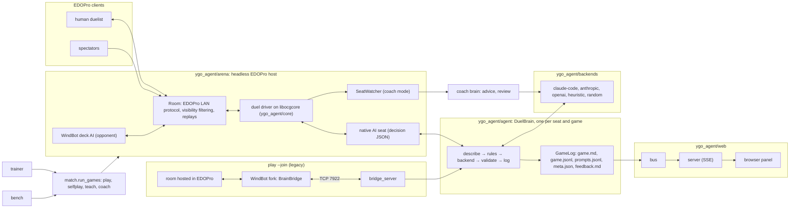

# Architecture

How ygo-agent is put together, as it is in the code. `CLAUDE.md` has the shorter code map; this page explains the
pieces and how a decision travels through them.



Two paths feed the agent. The usual one is the arena: the agent sits in the room it hosts, as a **native seat**,
next to a human, spectators or a WindBot deck AI. The older one is the WindBot fork: a WindBot that joins a room you
host in EDOPro and asks the agent for every decision over TCP (`play --join`, `teach --join`). Both produce the same
decision JSON ([decision-protocol.md](decision-protocol.md)), so the agent, the text it shows the model, the deck
rules and the saved regression cases are the same whichever path a game came through.

## The decision loop

`DuelBrain` (`ygo_agent/agent/brain.py`) is one seat in one game: the arena's native seat, the bridge server and
the coach each create a fresh one per game.

**Events become history.** Every event the seat receives (draws, moves, summons, chain links, attacks, damage,
chat) is turned into a line of English by `describe.py` and appended to the duel history, the same lines that go to
`game.md` and the web panel. A chat line starting with `!` is a coaching note: it is saved to the game's
`feedback.md` with the turn and the decision it followed. The agent sends no chat, including acknowledgments.

**A decision goes through, in order:**

1. A multi-card pick the model already planned continues by itself (`select_unselect` prompts of the same
   selection), and after an engine `retry` a random legal answer replaces the one the engine refused.
2. Built-in rules answer what never needs a model: `go_first` from the deck's `go_first` setting, zone placement,
   prompts with a single option, a card-name declaration with more than 150 names. These are logged as `auto`.
3. The deck's hard rules (`decks/<deck>/rules.py`, see [Decks](#decks)) run next; a rule that answers is logged as
   `rule:<name>`.
4. Otherwise the backend is asked. The brain keeps **one backend session per game turn**: it opens the session when
   the turn starts (pre-warming, so the first decision doesn't pay the start-up), and starts a fresh one after
   `max_session_messages` decisions. A session's first message carries the duel log so far (the last
   `history_lines` lines) and, when a session starts mid-turn, the carry-over: the last plan the model gave this
   turn and the turn's decisions so far, so it keeps its line. Every message then adds the events since the last
   decision, the texts of cards the session hasn't seen yet, the board as the seat sees it, the question and the
   numbered options. The reply is JSON: `choice` (option indices), `why` and an optional `plan`.
5. `validate.py` checks the reply against the decision: distinct in-range indices, the count the prompt kind allows,
   the sum for `select_sum`, `[]` only where passing or cancelling is allowed. An invalid reply gets one corrective
   re-ask with the reason; a second failure, a timeout or a backend error becomes a **fallback**: with
   `agent.fallback = "bot"` the reply is `choice: null` and WindBot's own AI answers, with `"heuristic"` (what
   native seats use) the heuristic policy answers.
6. The choice, the reason, the plan and who decided are echoed in the terminal, written to the logs and published
   to the web bus.

**The system prompt** (`prompts.py`) is built once per game: who the AI is in this mode (`play`, `selfplay`, `teach`
or `coach`) and who it plays against, the rules in force (the room's real duel flags, named as Master Rule 3 and so
on, else `[duel] rules` from the config), the teaching or coaching instructions in those modes, the general
strategy in `playbooks/general.md`, the deck list with each card's text (`card_texts`: full, compact or none) and
the deck's `playbook.md`.

**What is logged where.** Each game gets `games/<time>_<deck>-vs-<opponent>/` (`games/latest` points at the
newest): `game.md`, the readable log with every event and every decision (options, the choice, the reason, the
plan, who decided and how long it took); `game.jsonl`, the raw events, decisions and replies exactly as exchanged,
which `ygo-agent replay` and the saved cases replay; `prompts.jsonl`, every message the backend saw and its reply,
with time and tokens; `meta.json`, the deck, mode, backend profile (non-secret keys only), rules, opponent, result
and the game's stats (`stats.py`: decisions by source, latency, invalid replies, fallbacks, tokens, cost);
`feedback.md`, the `!notes` and panel notes; and `replay.yrpX`, the EDOPro replay of an arena game (`play --join`
games link the WindBot log instead, and EDOPro saves their replay). A match run also writes
`games/matches/<time>_<a>-vs-<b>/results.json` with every game's result and each seat's log folder.

## The arena

`ygo_agent/arena` is a headless EDOPro host written in Python, on top of `ygo_agent/core`: a ctypes binding to the
`libocgcore` that EDOPro itself loads, the card data from its `.cdb` files and its Lua scripts in EDOPro's own search
order (repositories first), found the way EDOPro's `configs.json` describes them.

- **Rooms** (`server.py`) speak EDOPro's LAN protocol to real clients: the lobby (join, ready, duelist or spectator
  positions, kick, start), deck upload with EDOPro's deck checks and banlists, the rock-paper-scissors and who goes
  first, the duel's message stream and the players' responses, the time limit, surrender, chat, best-of matches
  with side decking and rematches, a spectator joining mid-duel (catch-up), and LAN discovery so the room shows up
  in EDOPro's list (`[arena] lan`). One room has two duelist positions and any number of spectators. The agent's
  seats, a human's client and WindBot deck AIs are all participants of the same room.
- **The duel driver** (`duel.py`) runs one game on the core with EDOPro's host behaviour around it, including
  Multirole's handling of a refused response (the prompt is re-sent once). Seeds make games reproducible, and
  stacked hands put chosen cards on top of a deck (the trainer's lab, `selfplay --stack-a`).
- **Visibility** (`visibility.py`) filters every core message per player and for spectators, message by message as
  EDOPro's host does, and is stricter in a few places where EDOPro forwards a code a player shouldn't learn. A
  native seat sees exactly what its EDOPro client would see; the fairness tests in `tests/native/` check that.
- **Native seats** (`native_seat.py`, with `native_view.py` and `native_decide.py`) build the decision JSON from the
  seat's filtered stream plus core queries, so the state carries the core's current values, and encode the agent's
  choice back into a core response. A `SeatWatcher` builds the same view for a seat it doesn't play, which is how
  coach mode follows the human. Two AI seats with nobody watching play in-process, with no sockets (`runner.py`).
- **WindBot deck AIs** (`windbot.py`) are launched with mono from the fork build (or EDOPro's bundled WindBot),
  plain, and join the room as players; `python -m ygo_agent.arena list-bots` lists the ones available.
- **Replays** (`replay.py`) are EDOPro's `.yrpX` files with the embedded old-style `.yrp`, so every arena game opens
  in EDOPro's replay menu.
- `client.py` is a small EDOPro-protocol client in Python; the tests use it as the human (coach mode) or a
  spectator. `python -m ygo_agent.arena` has the low-level tools: `host`, `bots`, `selfplay-direct`, `list-bots`,
  `replay-info`.

`ygo_agent/match.py` is the one API every arena-hosted command runs on: `run_games(seat_a, seat_b, games=...)`
takes seat specs (`<deck>[:<backend>]`, `heuristic`, `random`, `windbot:<deck AI>`, `human`), picks in-process
games or a room, runs them `parallel` at a time, gives both seats of a duel one web-panel game, collects each
game's result, stats, log folder and replay, and writes the run's `results.json`. `play`, `selfplay`, `teach` and
`coach` are thin layers over it, and the trainer and the benchmark call it directly.

## Decks

A deck is a folder: `decks/<name>/` for the decks that ship with the repo, or your decks dir
(`~/.local/share/ygo-agent/decks/`, `[decks] user_dir`) for the ones you train; `ygo_agent/decks.py` resolves a deck
name through both, and `ygo-agent decks` lists them. The folder holds `deck.ydk` (the list; `[decks.<name>] ydk` in
`config.local.toml` points at the EDOPro copy instead, so edits made in EDOPro carry over), `deck.json` (the display
name, the `.ydk` path, whether to go first), `playbook.md`, `rules.py` and `tests/`. A loose `.ydk` can be played
too, with `<name>.md` next to it as its playbook.

- **The playbook** is what the model reads on every decision, so it stays under about 8 KB: principles first, phrased
  as conditions with their reason, which the model may override when the board calls for it; specific, repeatable
  mistakes become reusable cautions in an optional *Known pitfalls* section at the bottom. Dates, game IDs and
  match narratives belong in reports and regression cases, never in playbooks. `decks/geargia/playbook.md` is the reference, and
  `playbooks/general.md` holds what applies to every deck.
- **Feedback becomes lessons.** After a game, the user tells Claude Code what went wrong (`!notes` in `feedback.md`
  mark the moments). The procedure in `CLAUDE.md` finds the decision in `game.md`, works out whether the cause was
  judgment (fix the playbook), a wrong presentation of the state (fix `describe.py`) or wrong card data (check the
  script), and verifies with `ygo-agent replay games/<game> N`, which re-asks that decision with the current
  playbook and rules.
- **Hard rules** (`rules.py`) answer a decision before the model is asked. They are only for a mistake with no
  judgment in it that the play model repeats even with a playbook lesson, each marked with the regression case
  that proves it (`@cases`), because a rule overrides the model for every backend. `ygo-agent test --ablate-rules`
  replays each rule's cases with the rule disabled and reports the rules the model no longer needs.
- **Regression cases** (`tests/*.json`) are logged decisions saved with `ygo-agent replay ... --save`, with the
  acceptable choices (or the rejected one) and a note. `ygo-agent test` re-asks each of them a few times, since
  the model isn't deterministic; `pytest` checks, without any model call, that every case still describes,
  validates and doesn't contradict a rule.

[adding-a-deck.md](adding-a-deck.md) walks through creating one.

## Backends

A backend profile (`[backends.NAME]`, with a `type`) becomes a `Backend` that opens one session per game turn; a
session answers one decision at a time and keeps the conversation, so the corrective re-ask is just the next ask.
Types: `claude-code` (a persistent `claude -p` session, no API key), `anthropic`, `openai` (any OpenAI-compatible
server, with a tolerant parser for sloppy output), `heuristic` and `random` (no model; they decide from the raw
decision JSON and are the fallbacks and baselines), `scripted` (tests). Small-context models can shrink the prompt
per profile (`card_texts`, `history_lines`, `max_session_messages`). See [backends.md](backends.md) and
[adding-a-backend.md](adding-a-backend.md).

## The trainer and the benchmark

Both sit on `match.run_games`. The **trainer** (`ygo_agent/trainer`, `ygo-agent train`) turns a `.ydk` into a deck
folder: a dossier of every card and its script, a draft playbook written by a reviewer model, lab turns with
stacked hands against a dummy that never acts, games against WindBot deck AIs, reviews of each game against the
scripts and the engine log, and rounds of that until a round shows no significant mistake; every step is
checkpointed in the deck's `train/` folder, and every playbook edit is gated on the saved regression cases. See
[training.md](training.md). The **benchmark** (`ygo_agent/bench`, `ygo-agent bench`) plays the same decks,
opponents and seeds for every backend and reports win rates with intervals, ratings, latency, tokens, cost and
reliability; its **decision exam** re-asks logged positions of each model and has a blind judge grade them. See
[bench.md](bench.md).

## The coach

`ygo_agent/coach` (`ygo-agent coach`) hosts a room for the human, follows their seat through a `SeatWatcher`, and
asks a coaching `DuelBrain` for a recommendation on each decision, on its own threads so the duel never waits.
Trivial decisions and the ones a deck rule answers cost no model call; advice that arrives after the human moved is
marked late, and skipped Main Phase, Battle Phase and chain decisions get a short look back for the review, which
is written to `review.md` after the game. See [coach.md](coach.md).

## The web panel

`ygo_agent/web`: every `GameLog` publishes what it logs (events, decisions, replies, advice, notes) to an
in-process bus, a no-op until a panel runs; the server streams a game's backlog and live messages to the browser
over Server-Sent Events, serves card pictures and texts, rebuilds recorded games from their folders, and takes the
panel's notes. Standard library and vanilla HTML/JS only, bound to 127.0.0.1. See [web.md](web.md).

## The message protocol

[decision-protocol.md](decision-protocol.md) is the schema between a bot and the agent: the events, the state
object, every decision kind with its options and reply format, and how native seats build the same messages. The
WindBot fork's `BrainBridge` (`windbot-src/ExecutorBase/Game/BrainBridge.cs`) and the arena's native seats both
emit it; `bridge_server.py` is the TCP side for the fork. Keep the document in sync with any change on either side.

## Repository layout

```
README.md  CLAUDE.md  LICENSE  pyproject.toml  build.sh  play.sh
config/default.toml       every setting, commented; config.local.toml (gitignored) overrides it
playbooks/general.md      strategy that holds for every deck
decks/<name>/             deck.ydk, deck.json, playbook.md, rules.py, tests/*.json (train/ for a trained deck)
bench/                    configs/ (benchmark plans), results/ (runs), exams/ (decision exams)
docs/                     these pages; docs/bench/ the README's leaderboard and chart; docs/img/
games/                    game logs, match runs, replays (gitignored)
windbot-src/              the WindBot fork, branch brain-bridge (a git submodule)
tests/                    pytest: unit tests always; integration tests skip without EDOPro, mono or Firefox
ygo_agent/
  cli.py                  the ygo-agent command and its subcommands
  match.py                seat specs and run_games()
  config.py  decks.py  paths.py  cache.py  join.py (play --join)
  core/                   EDOPro install discovery, the libocgcore binding, card data, script lookup
  arena/                  rooms, the duel driver, visibility, native seats, WindBot launcher, replays, client
  agent/                  DuelBrain, describe, prompts, rules, validate, gamelog, stats, replay, ablation, bridge server
  backends/               claude-code, anthropic, openai-compatible, heuristic, random, scripted, the parser
  coach/                  live advice for a human seat, deck detection, the review
  trainer/                ygo-agent train: dossier, study, lab, games, reviews, playbook edits, report
  bench/                  benchmark plans, runner, metrics, reports, chart, the decision exam and its judge
  web/                    the panel: bus, server, renderer, recorded games, demo mode, static/
```
