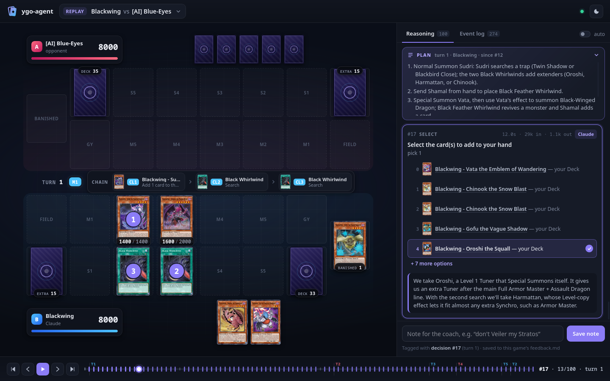

# Web app and panel

`ygo-agent web` is the whole app: start a duel, a game between AIs, a lesson or a coached game, train a new deck,
learn from your notes, edit a deck's playbook and tips, check the setup, and watch every game live on the board. It
runs the same commands you would type (each one is a *job*), so every terminal command stays as it is. The board
itself is the **panel**: the page that shows a duel as the agent plays it (the board with card pictures, every
decision with the options, what was chosen, why, and the plan for the turn, the event log, coach advice, and a note
box that works like a `!note` in the duel chat). `play/selfplay/teach/coach --web` serve the panel on its own.



Standard library only: an HTTP server with Server-Sent Events (`ygo_agent/web/server.py`) and vanilla HTML/CSS/JS
in `ygo_agent/web/static/`, with no build step and nothing from a CDN, so it works offline.

## The app

```sh
ygo-agent web --open                 # http://127.0.0.1:7930/ (--port, --host, --games-dir, --edopro-dir, --config)
ygo-agent web --demo games/<dir>     # the app, plus a recorded game replayed live
```

Pages (hash routes; the Games page is the panel below):

- **Home** (`#/`): four start cards. *Duel the agent* (its deck, backend, best of; more options: room password,
  your seconds per turn, and the legacy flow where you host the room and the WindBot fork joins). *Watch AI vs AI*
  (two seats, each an AI deck on a backend or a WindBot deck AI legal under the rules; games, pace, and "also watch
  in EDOPro", which waits for you as a spectator). *Watch it teach* (deck, backend, opponent, pace). *Get coached*
  (your deck, recognised from what you submit unless you pick one; the coach's backend; the advice level; the
  opponent). Then what is running, the recent games and the decks.
- **Decks** (`#/decks`) and a deck (`#/decks/NAME`): the playbook rendered, with Edit/Save (the previous text is
  kept as `<deck>/train/history/playbook-<time>.md`; a save is refused while a training or learn job works on the
  deck, or when the file changed since the page loaded); your tips (`tips.md`) with an "Add a tip" box; the pending
  notes, each opening its game at the decision it follows; **Learn** (what it does and a rough cost: about $1 and
  2-4 minutes per game with notes with Opus; enabled when there are notes, or tips changed since the last learn);
  the training report; the deck's games and jobs.
- **New deck** (`#/new`, then `#/new/NAME`): the train wizard. Pick a `.ydk` from EDOPro's deck folder or type a
  path, give it a name → *Read the deck* runs `train --interview-only` → the questions appear with their "why" →
  *Start training* saves the answers to `tips.md` and runs `train --resume --no-interview` with the options you set
  (reviewer, player, lab hands, games, rounds, budget) and an estimate of the cost and time (per-step figures
  measured on a Geargia run, scaled down for Sonnet or Haiku) → the progress (the trainer's output live, its lab hands
  and games as live games you can open) → the report. A stopped run shows a Resume form.
- **Games** (`#/games`): the panel. Opening a game anywhere in the app comes here.
- **Jobs** (`#/jobs`, `#/jobs/ID`): running and recent jobs; a job shows its equivalent terminal command, its
  output live, Stop, its games (and a "Watch on the board" button once one is live), and for a job that hosts a room
  the join instructions (LAN Mode → host 127.0.0.1, the port, the password) in a box you can't miss.
- **Setup** (`#/setup`): `ygo-agent doctor --json` as a table (run on the first visit, again with a button), the
  backend profiles and whether each can run, where the config, decks, games, EDOPro and job logs are, and how to
  change settings in `config.local.toml`.

A new live game from a job pops up a notice with "Watch it" when you're on another page. It works at 1024 px and on
a phone (the nav turns into icons, forms stack).

### Jobs

`ygo_agent/web/jobs.py`. A job is `python -m ygo_agent <argv>` (the interpreter running the app, so the same
code), started in the repo with stdin closed, in its own session and process group, its output (stdout and stderr,
ANSI colours stripped when served) in `~/.cache/ygo-agent/web-jobs/<id>.log` and its record in `<id>.json` (the 200
newest are kept). The argv is built from validated parameters only, never from free-form text and never through a
shell, and every value goes in as `--flag=value`:

| kind | parameters | argv (after `ygo-agent`) |
|---|---|---|
| `play` | `deck`, `backend`, `best_of`, `games`?, `time_limit`?, `password`?, `port`? | `play --deck=D --backend=B --best-of=N [--games=K] [--time-limit=S] [--port=P] [--password=X] --no-web` |
| `play` + `join` | `deck`, `backend`, `host`?, `port`?, `password`? (needs the WindBot fork built) | `play --join --deck=D --backend=B [--host=H] [--port=P] [--password=X] --no-web` |
| `selfplay` | `a`, `b` (seats), `games`, `best_of`, `pace`?, `parallel`?, `spectate`, `port`?, `password`? | `selfplay --a=SEAT --b=SEAT --games=N --best-of=N [--pace=S] [--parallel=K] [--spectate [--port=P]] --no-web` |
| `teach` | `deck`, `backend`, `opponent` (a seat), `games`, `pace`?, `port`? | `teach --deck=D --backend=B --opponent=SEAT --games=N [--pace=S] [--port=P] --no-web` |
| `coach` | `deck`? (else recognised), `backend`, `opponent`, `level`, `best_of`, `games`?, `time_limit`?, `port`? | `coach [--deck=D] --backend=B --opponent=SEAT --level=L --best-of=N [--games=K] [--time-limit=S] --no-web` |
| `train-interview` | `ydk`, `name`, `display_name`? | `train YDK --name=N [--display-name=X] --interview-only` |
| `train` | `name`, `backend`?, `player_backend`?, `games`?, `lab_hands`?, `max_rounds`?, `budget_usd`? | `train --name=N --resume --no-interview [--backend=B] [--player-backend=B] [--games=K] [--lab-hands=K] [--max-rounds=K] [--budget-usd=X]` |
| `learn` | `deck`, `backend`?, `budget_usd`? | `learn --deck=D [--backend=B] [--budget-usd=X]` |
| `doctor` | none | `doctor --json` |

A seat is `{"kind": "agent", "deck", "backend"}` (→ `deck:backend`; `heuristic` and `random` are backends) or
`{"kind": "windbot", "name"}` (→ `windbot:NAME`). The app's own `--config`, `--edopro-dir` and `--games-dir` are
passed on to the commands that take them (play, selfplay, teach, coach; train and doctor take the first two), so the
games a job plays land where the app looks.

- **Checks.** Decks resolve through `decks.find` (a name, any case; a new deck's name is 1-40 letters, digits, `-`
  and `_`, and mustn't clash with a deck in the other decks folder); backends must be `[backends.NAME]` profiles;
  WindBot deck AIs must be on the legal list (bots.json allows the rules and the deck has no Link monsters, the
  trainer's check); numbers are range-checked (best of 1/3/5, games, pace, ports 1024-65535, budgets); a `.ydk`
  path must, after following links, be an existing file ending in `.ydk`; passwords and names have no control
  characters. A `train` needs a training folder (the interview ran).
- **One room at a time.** play, teach, coach, selfplay with a spectator and play --join use the room port (or the
  bridge port): a second one is refused with the job that holds it (409), and a hosting job whose port is taken
  (EDOPro hosting, say) is refused before it starts. `train-interview`, `train` and `learn` take their deck: one at
  a time per deck.
- **Stop** sends SIGINT to the job's process group (Ctrl+C: a room closes and prints its results, the trainer
  checkpoints), SIGTERM after 20 s, SIGKILL after 5 more. When a job ends, anything left of it is killed: its
  process group, and any process whose environment carries its relay token (a WindBot runs in its own session).
  Ctrl+C on `ygo-agent web` stops every running job the same way (a second Ctrl+C kills them); a restarted app finds
  the jobs a crashed one left running by their token and stops them.
- **Waiting for you.** Where a terminal would wait for Enter, a job tells the app what it waits for and shows a
  button: "Start without a spectator" (selfplay `--spectate`, teach: the spectator gate also accepts the button) and
  "The room is open: send the bot" / "Play again" (play --join). The button creates the job's
  `<id>.go` file (`YGO_AGENT_GO_FILE`), which the command consumes. Nothing in a job reads stdin: the end-of-run
  "press Enter" prompts only appear on a terminal, and the trainer's interview is split (`--interview-only`, then
  `--no-interview`).

### The relay

How a job's games reach the app's board (`ygo_agent/web/relay.py`). Every job is started with `YGO_AGENT_RELAY`
(the app's URL) and `YGO_AGENT_RELAY_TOKEN` (that job's own random token). `cli.main()` calls `relay.install()`
for every command but `web`: with those variables set it switches the process's bus on with the usual renderer
(built from the card database on first use, or the command's own through `load_db`), so messages leave rendered
exactly as a panel in that process would show them, plus a sink that queues each message and posts batches (about
1 MiB) to `POST /api/relay` from a background thread. A POST that fails (the app is gone) drops its batch and the
sender pauses for 2 s; publishing never waits. At exit the queue is flushed (up to 3 s), so the game's end arrives.
`ensure_panel()` in a job returns the app's address instead of starting a server.

Every GameLog publishes through the bus, so play, selfplay, teach, coach and the trainer's lab hands and games all
show up live in the app (the trainer's are ordinary GameLogs with `echo`, so nothing changed there). The app checks
the token (constant-time, against each job) and the client address (loopback only), takes bodies up to 8 MiB, and
injects the messages into its own bus with `Bus.inject` (numbered in its own sequence, not rendered again). It
learns each job's games from their `game_start`/`meta`/`game_end` messages; when a job ends mid-game, its game gets a
`meta` with `result: "unfinished"` so it doesn't stay live. A note typed on a relayed live game can't reach the
job's DuelBrain, so it goes straight into that game folder's `feedback.md` (the folder from `seat_info(...)["dir"]`),
tagged with the seat's newest decision on the bus, as a `!note` would be.

### App endpoints

Only `ygo-agent web` serves them (a panel from `play --web` answers `/api/app` with `{"app": false}` and the rest
with 404). All of them, and every POST, also require a loopback client address, whatever `--host` binds, on top of
the Host/Origin checks every request gets; POST bodies are JSON, at most 64 KiB (1 MiB for a playbook, 8 MiB for
the relay).

| endpoint | |
|---|---|
| `GET /api/app` | `{"app": true, "version", "backends": [{name, type, model, effort, label, ok, problem}], "default_backend", "default_deck", "rules", "windbots": [{name, deck, difficulty}], "windbot_problems", "join_available", "edopro_dir", "edopro_decks": [{name, path}], "decks_dirs", "games_dir", "jobs_dir", "config": {default, local, local_exists}, "room", "trainer", "coach"}` |
| `GET /api/decks` | `{"decks": [...]}`: `decks.listing` rows plus `tips`, `pending_notes` (the owner's notes not learned yet), `other_notes`, `games`, `train` (`{status, updated, cost}` from `train/state.json`, or `interview`), `last_game`; a deck a training run has started but not set up yet has `training_only` |
| `GET /api/decks/NAME` | the row plus `playbook`, `playbook_sha`, `tips_entries`, `pending` (`Note.to_dict()` + `recorded`: the game's folder name), `other_pending`, `tips_changed`, `report` (`{path, markdown}`), `interview`, `games_list`, `learn_log`, `jobs`, `busy` |
| `POST /api/decks/NAME/playbook` | `{"text", "base"?}` (`base`: the `playbook_sha` it was loaded with) → `{ok, sha, bytes, history}`; 409 when the file changed or a job is working on the deck |
| `POST /api/decks/NAME/tips` | `{"text", "title"?}` → `{ok, tips}` (`tips.add`) |
| `POST /api/decks/NAME/interview` | `{"answers": [{question, answer}]}` → `{ok, saved, tips}` (`tips.save_answers`; empty answers are skipped) |
| `GET /api/jobs` | `{"jobs": [...]}`, running first: `{id, kind, title, params, argv, command, status (starting/running/stopping/done/failed/stopped), code, running, started, ended, pid, log, room, deck, games: [{game_id, seat, dir, name, ended, live, title, on_bus, recorded}], waiting, error}` |
| `POST /api/jobs` | `{"kind", "params"}` → `{job}`; 400 for bad parameters, 409 for a busy room or deck |
| `GET /api/jobs/ID?offset=N` | `{job, output: {offset, next, size, text}}`: the log from byte N (`-1`: its last 64 KiB), whole lines while it runs; a finished doctor job has `job.result` (its JSON) |
| `POST /api/jobs/ID/stop` | Stop (above) → `{job}` |
| `POST /api/jobs/ID/go` | the button for what the job waits for → `{job}`; 409 when it waits for nothing |
| `POST /api/relay` | `{"messages": [...], "waiting"?: {text, button} or null}` with `X-Relay-Token` → `{ok, n}` |

## The panel

```sh
ygo-agent play --web                 # also selfplay/teach/coach --web, and the legacy --join flows; prints http://127.0.0.1:7930/
ygo-agent web                        # the app: browse games/* and replay any of them, start new ones
ygo-agent web --demo games/<dir> --speed 2   # replay a recorded game live, as if it were being played now
```

- `--web-port N` (play/selfplay/teach/coach) or `--port N` (web) picks the port. `[web]` in `config/default.toml`
  holds the defaults: `auto` (start it with every play/selfplay/teach/coach run without `--web`; `--no-web` turns
  it off for one run), `host` (`127.0.0.1`; keep it local, since the panel serves your logs
  and writes notes), `port` (7930), `open_browser`, `fetch_pics`.
- `--demo` paces the game for watching: about the real rhythm, with thinking time taken from each reply's latency
  (capped at 6 s, divided by `--speed`), and quick events squeezed. `--loop` restarts it. It's meant for the README
  GIF and for trying the panel without playing. The demo is a live game until its `game_end` (the recorded result,
  end time and stats are published last).
- The panel lives in the process that plays: `ygo-agent web` in another terminal shows the games of the jobs it
  starts (through the relay), recorded games and demos, not the games of a `play` you started in a terminal. Use
  `play --web` for those, or start the duel from the app.

Using it:

- **Board**: the seat being viewed is at the bottom. Hover any card (board, hand, options, chain, log) for the large
  picture and full text. Click GY, banished or Extra Deck for the list. Defense-position cards are turned sideways;
  the opponent's face-down cards are card backs, your own set cards show their face dimmed with a SET tag.
  Chain links show as numbered markers on the cards and as a chain bar in the middle strip. Attacks draw an arrow,
  targets get a ring, LP changes animate.
- **Reasoning**: one card per decision, newest at the bottom. The chosen option is highlighted (multi-card picks
  are numbered in pick order), then the reason, the source badge (backend label, `rule · name`, `fallback`, `auto`,
  `you` for a coached human's own move, `pilot` in old copilot logs) and the latency and tokens. The current turn's
  plan stays at the top. Auto-scroll pauses when you scroll up; "Latest" resumes it. The `auto` switch shows
  decisions the agent made without asking (only one choice, planned picks). Zone placements are left out.
- **Coach games** (`ygo-agent coach --web`, docs/coach.md): your own seat at the bottom. Each card marks the coach's
  pick (dashed, `COACH`) and your move (✓), says `followed coach` or `diverged` (and `late` or `looked back` when
  the advice came after your move), and has the coach's reason and plan in a green line; while you think it says
  "waiting for your move", while the coach thinks "coach is thinking". Decisions the coach didn't weigh in on are
  `auto` cards. The timeline marks your moves green, or amber where you diverged. After the game the coach's review
  opens in a **Review** tab.
- **Timeline** (bottom): every decision of the game, coloured by source, with turn marks. Click or drag to scrub;
  the board, the reasoning and the log show the game as of that decision. Keys: `←`/`→` decision, `Shift+←/→`
  turn, `Home`/`End`, `Space` play/pause, `L` back to live, `G` games, `N` the note box, `Esc` close. Keys typed in
  the note box (or any field) never move the timeline.
- **Live or paused.** In a game still being played the board follows the newest decision and the events since. It
  leaves the live view only on an explicit move: a scrub, the arrow keys, `Home`, or a click on an *older*
  decision card (clicking the newest one, scrolling the reasoning list or a paused auto-scroll never do). While it
  shows an earlier decision, the board is dimmed, a bar over it says "Viewing decision #N (turn T), not live" with
  a **Back to live** button, and the header chip reads `PAUSED AT #N` instead of `LIVE`; `Esc`, `End`, `L`, the
  button, or stepping forward onto the newest decision follow the game again.
- **Render errors.** Each message is handled on its own: one the page can't render is logged to the browser
  console and counted in a small red "render error" chip in the header (hover it for the message), and the board
  and the timeline carry on with the next one.
- **Feedback box**: saves the note to the game's `feedback.md` in the same format as a `!note` from the chat,
  `- (turn T, right after decision #N) text`. During a live game it goes through the seat's DuelBrain (same counter,
  and `game.md` gets a "Web panel feedback" line); if you scrolled back, it is tagged with the decision on screen. For
  a recorded game it is appended to that folder's `feedback.md`.
- **God view** reveals both hands and face-down monsters and Spell/Trap cards in every locally hosted mode,
  including AI vs AI, play, teach and coach. Viewer-only snapshots are saved for replay; AI and coach prompts
  still receive their normal private views. Older logs and games joined on an external host can only reveal
  identities they actually recorded.
- **Self-play** (two seats in one game): seat tabs switch the bottom side; "both" shows both seats' reasoning.
- **Games** (`G`, or the title): live games on the bus and every log under `games/`.

Card pictures come from `~/Games/ProjectIgnis/pics`. A missing one is downloaded from the URL EDOPro uses
(`config/user_configs.json`, then `config/configs.json`; `"default"` means
`https://pics.projectignis.org:2096/pics/{}.jpg`), cached in `~/.cache/ygo-agent/pics/`, and replaced by a
generated card (name, type, ATK/DEF) when offline. A failed download isn't retried for 10 minutes.

## How it fits together

```
DuelBrain ─▶ GameLog ─▶ Channel(game_id, seat) ─▶ Bus ──(Renderer: describe.py words, card names)──▶ backlog
                                                   │                                                    │
                                     feedback ◀────┘                    server.py: /stream (SSE) ◀──────┘
                                  (panel_note)                         /api/*, /card/*, /cardinfo/*

a job of the app:  Bus ──(relay sink: batched POSTs)──▶ app /api/relay ──Bus.inject──▶ the app's Bus (as above)
```

- **Hook.** `GameLog` (`ygo_agent/agent/gamelog.py`) already sees every event, decision, reply and prompt, so it is
  the only publisher: each log has a `web` Channel. Any seat that logs through a GameLog (native arena seats, the
  WindBot bridge, the coached human's seat) is on the panel for free. While no panel runs, `Channel.send` returns at once.
  Quiet logs (replays, tests) don't publish unless created with `publish=True`.
- **Ids.** `GameLog(..., game_id=, seat=)` and `DuelBrain(..., game_id=, seat=)`. The default game id is the log
  folder's first name; two seats of one game must pass the same `game_id` and their own `seat`.
- **Bus** (`ygo_agent/web/bus.py`): thread-safe, in-process. Each game keeps a backlog (50k messages; the 16 newest
  games, finished ones dropped first), so a browser that opens mid-game catches up. `Channel.send` deep-copies the
  payload, because the brain keeps editing its own dicts.
- **Renderer** (`render.py`): adds the display text to every message as it is published, using the same
  `describe.py` the model's prompt uses, plus a brief of each card the game mentions (sent once per game).
- **Server** (`server.py`): `ThreadingHTTPServer`, one thread per request. It refuses requests whose `Host` or
  `Origin` isn't local (DNS rebinding, cross-site posts) and only takes JSON posts of up to 64 KiB (the app's
  playbook saves and relay batches excepted, above). With `ygo-agent web` it serves `index.html` with
  `data-mode="app"`, which makes `static/shell.js` draw the app's pages around the viewer (`static/app.js`);
  `app.py` answers the app's endpoints.
- **Recorded games** (`recorded.py`): rebuilds the same messages from a game folder: `game.jsonl` (events,
  decisions, and replies in logs since Stage 0), `game.md` (choice, source, reasoning and plan of every decision,
  for old logs too), `prompts.jsonl` (the backend's own reply, time and tokens) and `feedback.md`.

| endpoint | |
|---|---|
| `GET /stream?game=ID` | SSE. First `{"type": "games", "games": [...]}`, then the game's backlog (after `Last-Event-ID`, which browsers send when they reconnect), `{"type": "caught_up"}`, then live messages. Summary messages of other games (`game_start`, `meta`, `game_end`) come too, without an SSE id. `/stream` without a game sends only those. |
| `GET /api/games` | `{"live": [summary...], "recorded": [summary...]}` |
| `GET /api/recorded/NAME` | `{"name", "summary", "messages": [...]}`: a recorded game as bus messages (game id `rec:NAME`) |
| `GET /card/CODE.jpg` | the picture (JPEG/PNG), or the placeholder SVG |
| `GET /cardinfo/CODE` | `{"id", "name", "type_line", "text", "type", "atk", "def", "level", "scale"?, "attribute", "race", "alias", "extra"}` |
| `POST /api/feedback` | `{"game_id", "seat", "text", "decision"?, "turn"?}` → `{"ok", "live", "n", "context", "file"?}` |

## Message schema

Every message is a JSON object with `type`, `game_id`, `seat` (the publishing seat, 0 or 1; in its payload
"me"/player 0 is that seat, as in `docs/decision-protocol.md`), `ts` (unix seconds) and `seq` (per game, from 1;
the bus sets it). Publishers send through `Channel(game_id, seat).send(type, **fields)` or
`BUS.publish({...})`. The renderer adds the fields marked *(rendered)*.

| type | fields | from |
|---|---|---|
| `game_start` | `deck`, `deck_name`, `dir` (log folder), `name`; `demo` / `recorded` (bool, optional) | a seat's GameLog is created |
| `meta` | any of `deck`, `deck_name`, `mode` (`play`, `selfplay`, `teach`, `coach`; `copilot` in old logs), `backend` (`{label, name, type, model…}`), `rules`, `opponent`, `first`, `started`, `result`, `ended`, `stats`, `dir`, `name` | `GameLog.write_meta` (same keys as `meta.json`) |
| `event` | `ev`: the raw bridge event; `text` *(rendered)*: the `describe.py` line or null; `desc_text` *(rendered, chaining)*; `cards` *(rendered)* | every event |
| `decision` | `decision`: the raw decide message (with `state`); `question`, `options` *(rendered)*: the prompt's question and option lines; `hint_text` *(rendered, selections)*; `cards` *(rendered)*: `{code: {n, t, atk, def, lv}}` | every decision except `game_over` |
| `reply` | `id`, `choice` (every pick, also for `select_unselect`, where the bot is sent one per prompt), `sent` (what went to the bot), `source` (`backend`, `rule:<name>`, `auto`, `fallback`, `human` (a coached human's move), `game_over`; `pilot` in old copilot logs), `why`, `plan`, `label` (backend label), `seconds` (for `human`: their thinking time), `note` (warning), `usage` (`seconds`, `input_tokens`, `output_tokens`, `cache_read_tokens`, `cache_write_tokens`, `cost_usd`, `error`; for `human`, the coach's usage is on its `advice`), `say`, `suggested` (old copilot logs), `trivial` and `advised` (coach games) | the reply record, merged with the logged decision and the backend's usage |
| `advice` | `id` (the decision), `choice` (null: no advice), `why`, `plan`, `source` (`backend`, `rule:<name>`, `auto`, `skipped`: the human answered before the coach got to it, `failed`), `label`, `seconds` (backend time), `after` (seconds from the decision to the advice), `late` (bool: the human had already answered), `hindsight` (bool: a look back at an answered decision), `kind`, `usage` | coach mode: a recommendation for the human's seat, before or after their move |
| `human_choice` | `id`, `choice`, `advised`, `matched` (bool; for `select_unselect`, the first advised pick) | what the human did, published with whichever of `advice` and their `reply` comes second (advice with a choice only) |
| `review` | `markdown` (review.md), `path`, `seconds`, `label` (the review backend) | coach mode: the review after the game (recorded coach games replay it last) |
| `feedback_ack` | `text`, `context` (`turn T, right after decision #N`), `who` (`Opponent`, `Spectator`, `Web panel`) | a note was saved (chat `!note` or the panel) |
| `game_end` | `result` (`win` / `loss` / `draw`, for this seat), `reason`, `reason_text` *(rendered)* | the `win` event |

A decision card in the panel is the `decision` plus whatever arrives later for the same `(seat, id)`: `reply`,
`advice`, `human_choice`. A decision with neither a reply nor a human choice shows as "thinking"; in a coach game, as
"waiting for your move" (with the coach's line once its advice is in).

### What later stages publish

- **Stage 4 (self-play, several seats), done.** `ygo_agent.match.run_games` links the two AI seats of every duel
  (`native_seat.link`), so each seat's `DuelBrain(..., game_id=G, seat=S)` shares `G`: `<run>-m<match>-g<game>`
  in-process, `<run>-g<game>` in a room (`<run>-r<room>-g<game>` with parallel rooms), where `<run>` is the run
  folder's name (with a short hash of its path when the caller chose the folder, as the trainer and the bench do, so two runs never share an id). The panel shows both seats, seat tabs and god view. Parallel games are
  separate games in the list. A seat that logs quietly must pass `publish=True`; the terminal's `--quiet` (echo
  "key") still publishes everything.
- **Stage 5 (coach), done.** The coached seat's GameLog publishes the `decision` (the human's own view) at once,
  `advice` when the coach answers (`GameLog.advice()`, `late: true` if the human already chose), the human's move as
  a `reply` with `source: "human"`, and `human_choice` with whichever of the two comes second; then the `review`.
  An AI opponent in a coach game doesn't publish (its reasoning and hand would show).

## Screenshots

`docs/img/` holds `web-panel.png` (1440×900), `web-panel-1024.png`, `web-panel-light.png` and `web-games.png`,
taken from replays of real recorded games, and `demo.gif` (960 px wide, 8 fps, 15 s: the first turn of an Opus
Blackwing game in the dark theme, 120 frames taken every 400 ms at 1440×900, the first two skipped). To retake
them, or to record frames of a demo for a GIF:

```sh
ygo-agent web --port 7931 &                     # or: ygo-agent web --demo games/<dir> --speed 2 --port 7931 &
node tests/web/shoot.mjs "http://127.0.0.1:7931/?game=rec:<dir>&d=17&theme=dark" docs/img/web-panel.png 1440x900
node tests/web/shoot.mjs frames.json            # [{"url": ..., "out": "frames/f%03d.png", "frames": 120, "every": 250}]
ffmpeg -framerate 4 -start_number 2 -i frames/f%03d.png -vf "fps=8,scale=960:-1:flags=lanczos,split[a][b];[a]palettegen=max_colors=128:stats_mode=diff[p];[b][p]paletteuse=dither=bayer:diff_mode=rectangle" docs/img/demo.gif
```

`shoot.mjs` drives headless Firefox over WebDriver BiDi with Node 22's built-in WebSocket, so nothing needs
installing. Page parameters: `game=rec:<dir>` or a live game id, `d=<decision id>`, `theme=dark|light`, `tab=log`,
`seat=1`. The app's pages are hash routes after them (`http://127.0.0.1:7931/#/decks/geargia`); `web-app-home.png`
and `web-app-deck.png` are the app's Home and a deck page at 1440×900.

## Tests

`tests/web/`: the bus (backlog, catch-up, several games and seats, eviction, SSE frames, the renderer); the GameLog
hook on a saved regression case (every decision gets its reply, the texts match `describe.py`, coach advice and the
human's move in either order, two seats in one game, panel notes in `feedback.md`); recorded games (`game.md` parsing, current and
pre-Stage-0 logs, every game under `games/` when there are any, demo mode through the bus); and the server over
urllib (static files, APIs, pictures local / downloaded and cached / placeholder, SSE resume, the feedback endpoint,
refused cross-site requests). The app: `test_web_jobs.py` (every kind's argv, bad decks/backends/numbers/paths/names
refused, and the lifecycle with a fake command: output, Stop by Ctrl+C then SIGTERM, leftovers killed by token, one
room and one job per deck, a restarted app stopping orphans, the go button) and `test_web_app.py` (the endpoints:
decks, notes, playbook saves with history, tips, interview answers, jobs; the relay: token, loopback only, messages
injected without re-rendering, notes on a relayed game landing in its folder, a stopped job's game ended; the
job-side sender batching and never blocking; a `play --web` panel without jobs).

`tests/web/test_web_browser.py` (integration: the EDOPro install, Firefox and Node 22) follows live games in headless
Firefox through `tests/web/check.mjs`, a small WebDriver BiDi step runner that also collects console errors: a native
arena game (`tests/fixtures/web/native-place-game`, the game whose board once froze) replayed through a DuelBrain onto
the bus the way a live seat publishes it (`tests/web/live_replay.py`, also runnable by hand), the same game with
native-only message shapes slipped in (coin/dice/equip/counter/swap/declared/confirm events, an `announce_card`
answered with a code, a multi-step `select_unselect`), and a heuristic-vs-random native self-play game. Each checks
that the board reaches the final turn and LP with no render error; the first also checks that clicking the newest
card keeps the board live and that an older one pauses it visibly.

## Known gaps

- Between decisions the board follows the events (moves, summons, position changes, Set cards flipped by their
  activation, LP, chain); it is resynced from the full state at every decision. A card moved by an event shows its
  printed ATK/DEF until then, and a negation (the `NEG` badge, e.g. from Fiendish Chain) shows from the next
  decision's state.
- The opponent's Xyz materials and counters appear only when the seat reports them (`ov`, and `ctr` from native
  seats).
- Pendulum and Extra Monster Zones are drawn only when occupied, in a simple way (MR3 never uses the EMZ).
- The trainer's lab hands and games log under the deck's `train/` folder, not the games folder: the app shows them
  live (and keeps the 16 newest games on its bus), but once they're gone from the bus the Games list doesn't offer
  them; the training report links their logs.
- A note typed on a job's live game goes to the game's `feedback.md` directly, without the "Web panel feedback" line
  a DuelBrain in the same process would add to `game.md`.
- The app doesn't run `bench`, `replay`, `test` or `train-compare`; those stay terminal commands.
